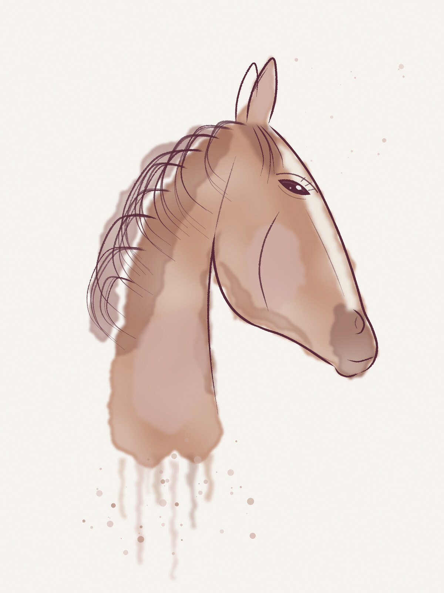

# Portrait aquarelle par IA : le style « Encre & Poudre »

> **Service retenu : Replicate.** Il est sélectionné par défaut ; il suffit d'enregistrer le jeton (voir « Mise en service »).
> **Page de vente dédiée : `/portrait-aquarelle`** (voir plus bas), à utiliser dans vos publicités, votre bio Instagram et vos e-mails.

La cliente envoie la photo de son cheval. En quelques secondes, l'IA la redessine dans le style maison. Elle voit l'aperçu dans son cadre, avec le nom et l'année de naissance du cheval, puis commande une **affiche encadrée** fabriquée par Printful.

## Le style

**« Encre & Poudre »** a été pensé pour plaire au plus grand nombre et rester dans la charte Crinière Club :

- **Le trait** : fin et sûr, à l'encre bordeaux (#5A2A3A), avec quelques traits libres dans la crinière.
- **La couleur** : des lavis d'aquarelle transparents. La vraie robe du cheval est gardée, mais adoucie vers le rose poudré, le beige et le taupe de la marque.
- **La composition** : la tête et le haut de l'encolure, beaucoup d'espace autour. L'encolure se fond en bas dans des coulures d'aquarelle.
- **Le support** : un papier crème uni, sans décor.
- **Ressemblance** : la forme de la tête, les marques (liste, étoile, balzanes), la robe et le harnachement sont conservés. Une propriétaire doit reconnaître son cheval au premier coup d'œil.
- **Sous le dessin** : le nom en écriture manuscrite (Allura), puis l'année de naissance, facultative, en capitales espacées entre deux filets.

Le style est décrit au modèle d'IA dans `App\Services\AiPortrait::STYLE_PROMPT`. La mise en page de l'affiche (`AiPortrait::LAYOUT`) est commune au fichier d'impression et à l'aperçu de la fiche produit. Ce que la cliente voit est donc ce qui sera imprimé.

## Le parcours cliente

1. Sur la fiche **« Portrait aquarelle de votre cheval, encadré »** (collection *Mon cheval, ma fierté*), elle ajoute une photo et accepte son envoi au service de dessin.
2. Elle clique sur **« Créer mon portrait »**. Une barre de progression s'affiche pendant 10 à 60 secondes selon le service.
3. L'aperçu apparaît dans le cadre, réduit et filigrané. Elle saisit le nom et l'année : l'aperçu se met à jour en direct, avec la couleur du cadre et le format choisis.
4. Si la version ne lui plaît pas, elle peut en **créer une autre**, dans la limite du quota du jour.
5. Elle **ajoute au panier**. Le portrait est rattaché à la ligne du panier, puis à la commande.
6. Au paiement, la boutique **compose le fichier d'impression**, l'envoie à Printful et la commande part en fabrication. Le fichier fait 3600 × 4800 px, soit 300 DPI en 30 × 40 cm, sans filigrane.

Dans l'administration, chaque article commandé montre la photo d'origine et le dessin IA (téléchargeables), ainsi que le nom et l'année.

## Mise en service (10 minutes)

Replicate est le service sélectionné par défaut. Tant que son jeton n'est pas enregistré, la boutique fonctionne en **mode démonstration**. Le dessin est alors un simple effet croquis calculé sur votre serveur, sans IA : il sert à tester le parcours de bout en bout, pas à vendre.

### 1. Le service : Replicate

Replicate est le service retenu. OpenAI reste disponible comme solution de secours :

| Service | Modèle par défaut | Points forts | Coût indicatif par création* |
|---|---|---|---|
| **Replicate** (recommandé) | `black-forest-labs/flux-kontext-pro` | Très fidèle aux marques du cheval, rapide (≈ 10 s), prix fixe | ≈ 0,04 $ |
| **OpenAI** | `gpt-image-1.5` | Très bon rendu aquarelle, qualité réglable | de quelques centimes (qualité *low*) à ≈ 0,20 $ (*high*) |

\* Indicatif : vérifiez les tarifs en vigueur sur le site du service. Une création en échec ne compte pas dans le quota de la cliente.

### 2. Créer le jeton Replicate

1. Créez un compte sur [replicate.com](https://replicate.com) (connexion possible avec un compte GitHub ou Google).
2. Ajoutez un moyen de paiement dans *Account › Billing*. Replicate facture à l'usage ; vous pouvez y fixer une limite de dépense mensuelle, en plus du plafond quotidien de la boutique.
3. Créez un jeton dans *Account › API tokens* (il commence par `r8_`). Gardez-le pour l'étape suivante, sans l'envoyer par e-mail ni par message.

- **OpenAI (secours)** : créez un compte sur [platform.openai.com](https://platform.openai.com), ajoutez du crédit (*Settings › Billing*), puis créez une clé dans *API keys* (`sk-…`). OpenAI peut demander de **vérifier votre organisation** avant d'ouvrir ses modèles d'image : suivez leur procédure si le test le signale.

### 3. L'enregistrer dans la boutique

Dans **Administration › Intégrations › Clés et jetons › Portrait IA** :

1. **Service de dessin** : `replicate` (déjà sélectionné).
2. Collez le jeton dans **Jeton API Replicate**, puis confirmez avec votre mot de passe administrateur. La clé est enregistrée **en base de données**, jamais dans les fichiers : elle est conservée lors des mises à jour.
3. En haut de la page, cliquez sur **Tester** sur la ligne « Portrait IA ».

Les clés ne doivent jamais être envoyées par e-mail ou par message. En cas de doute, révoquez-les et recréez-en une.

## Garde-fous et coûts

| Réglage (Intégrations › Portrait IA) | Par défaut | Rôle |
|---|---|---|
| Créations offertes par visiteuse et par jour | 3 | Limite par navigateur. La limite par connexion internet est trois fois plus large, pour les box et la 4G partagées. |
| Créations maximum par jour pour toute la boutique | 60 | **Plafond de coût** : au-delà, plus aucune création jusqu'au lendemain. 60 × 0,04 $ ≈ 2,40 $ par jour au maximum avec Replicate. |
| Qualité OpenAI | medium | `low` est le moins cher, `high` le plus fin. |

Autres protections :

- **Aperçu protégé** : avant l'achat, la cliente ne voit qu'un aperçu de 720 px filigrané. Le dessin pleine définition n'est publié, pour Printful, qu'une fois la commande payée.
- **Une seule création à la fois** par visiteuse. Une création bloquée plus de 5 minutes passe en échec.
- **Photos** : elles sont vérifiées, redressées, débarrassées de leurs métadonnées (GPS…) et stockées hors du web. Le navigateur réduit la photo à 2400 px avant l'envoi, ce qui accélère l'envoi en 4G.

## Printful : l'affiche encadrée

Le produit est créé automatiquement, avec les **ID variantes du catalogue Printful déjà renseignés**. Le support est *Enhanced Matte Paper Framed Poster (cm)*, produit n° 304, emplacement `default`.

| Variante boutique | Prix de vente | ID variante Printful |
|---|---|---|
| Noir / 30 × 40 cm | 79 € | 9357 |
| Blanc / 30 × 40 cm | 79 € | 10297 |
| Chêne / 30 × 40 cm | 84 € | 11791 |
| Noir / 45 × 61 cm | 119 € | 19646 |
| Blanc / 45 × 61 cm | 119 € | 19651 |

- Les proportions de la feuille suivent le format de la variante. Le 45 × 61 cm reçoit un fichier de 3600 × 4880 px.
- Pour ajouter un format ou vérifier un ID : **Produits › (fiche) › Trouver un ID variante catalogue ↗**. Recherchez par exemple « framed poster », ouvrez le produit, puis copiez l'ID de chaque variante.
- Par défaut, Printful reçoit les commandes **en brouillon** : vous les confirmez depuis l'administration. C'est l'occasion de jeter un œil au fichier avant la fabrication. Passez en confirmation automatique quand vous êtes en confiance (*Intégrations › Printful*).

## Agrandissement IA avant impression (activé)

FLUX Kontext produit des images d'environ 1 million de pixels. Pour un trait net en 30 × 40 cm comme en 45 × 61 cm, chaque dessin est **agrandi par IA** avec `recraft-ai/recraft-crisp-upscale` (≈ 0,004 $ par image), en arrière-plan dès qu'il est prêt. La boutique récupère la version agrandie pendant que la cliente saisit le nom, ou au plus tard grâce à la tâche planifiée : Replicate ne conserve les fichiers qu'environ une heure. Si l'agrandissement n'a pas abouti au moment de la commande, la version standard est imprimée. L'option se désactive dans *Intégrations › Portrait IA*.

## La page de vente `/portrait-aquarelle`

Une page entière est consacrée au portrait, accessible depuis le menu (« ✦ Portrait aquarelle »), l'accueil, le pied de page et le plan du site. Elle enchaîne :

1. **L'accroche** : promesse, bénéfices, double appel à l'action (« Créer son portrait gratuitement » / « Voir des exemples »), prix d'appel, réassurance et, à l'approche des fêtes, la **date limite pour Noël**, calculée d'après vos délais de fabrication et de livraison.
2. **Le style expliqué** : un portrait annoté de 5 repères (regard, trait, marques, aquarelle, nom).
3. **Six exemples** de robes et de cadres différents (alezan, bai, gris pommelé, palomino, noir, gris clair).
4. **Comment ça marche** en 3 étapes.
5. **Le créateur intégré** : le même bloc que la fiche produit (photo, création, aperçu encadré, nom, année, cadre, format, panier), sans quitter la page.
6. **Les occasions** (pour soi, à offrir, pour dire merci, en souvenir), puis les cadres, formats, prix réels et la date de livraison estimée.
7. **Les garanties**, les **avis** dès qu'il y en a, une **FAQ** (transmise à Google pour les résultats enrichis) et un dernier appel à l'action.

Conseils :
- Utilisez l'adresse `https://votre-domaine/portrait-aquarelle` dans vos publicités Meta et Pinterest et dans votre bio Instagram : c'est la page la plus convaincante pour un nouveau visiteur.
- Dès vos premières ventes, **remplacez les exemples** par de vrais portraits de clientes, avec leur accord : c'est la meilleure preuve sociale. Les fichiers sont dans `public/assets/img/portrait-ia/` (`exemple-*.jpg`, 600 × 800 px).
- Le compteur « Déjà N portraits créés » s'affiche automatiquement à partir de 100 portraits.

## Confidentialité (RGPD)

- La cliente coche une case de **consentement** avant l'envoi de sa photo au service de dessin.
- Les photos et portraits **non commandés sont supprimés automatiquement après 30 jours** par la tâche planifiée. Ceux des articles commandés sont conservés avec la commande, pour une éventuelle réimpression.
- La politique de confidentialité et la FAQ ont été complétées automatiquement lors de la mise à jour. Relisez-les dans *Administration › Pages*.

## Dépannage

| Symptôme | Solution |
|---|---|
| « Le dessin n'a pas pu être réalisé » | Consultez `storage/logs/ai-AAAA-MM.log` : clé invalide, crédit épuisé, organisation OpenAI non vérifiée… Le bouton **Tester** donne aussi le détail. |
| « Cette photo n'a pas pu être dessinée » | Le filtre de sécurité du service a refusé la photo (personne en gros plan, par exemple). Conseillez une photo où le cheval est seul. |
| La création tourne sans fin | Si l'hébergement interrompt une requête longue, la création passe en échec au bout de 5 minutes et ne compte pas. Replicate, plus rapide, est moins exposé. |
| La page `/portrait-aquarelle` répond « page introuvable » | La page s'affiche dès qu'un produit « Portrait IA » est **en ligne**. Depuis la version 1.6.2, il est créé automatiquement, avec la collection « Mon cheval, ma fierté » si elle manque. Vérifiez dans *Produits* qu'il n'a pas été mis hors ligne. |
| La commande reste « en erreur » | Vérifiez la ligne « Portrait IA » dans *Commandes › (commande)*, puis cliquez sur « Transmettre à Printful ». La tâche planifiée relance aussi automatiquement. |

## Personnaliser le style

- **Le texte du style** : `App\Services\AiPortrait::STYLE_PROMPT`, en anglais car les modèles le suivent mieux. Testez avec plusieurs photos avant de mettre en production.
- **La mise en page de l'affiche** : `AiPortrait::LAYOUT` (zone du dessin, position et taille du nom et de l'année). L'aperçu de la fiche produit lit les mêmes valeurs.
- **Les visuels de la fiche** : `public/assets/img/products/portrait-ia*.jpg`. L'exemple de style a été dessiné pour la boutique, en vectoriel.
