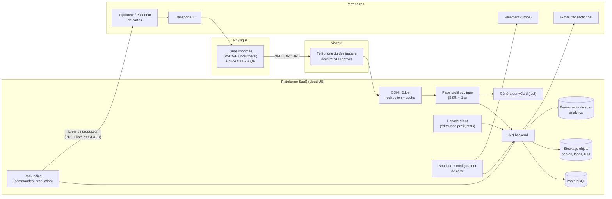
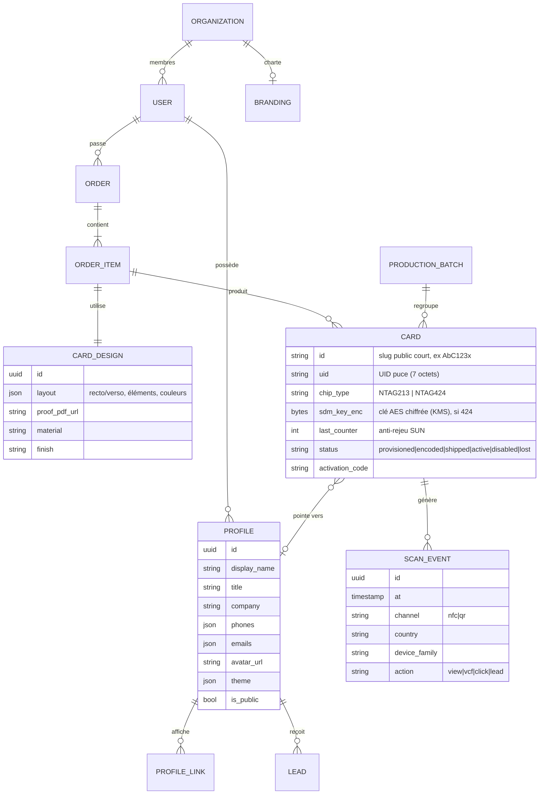
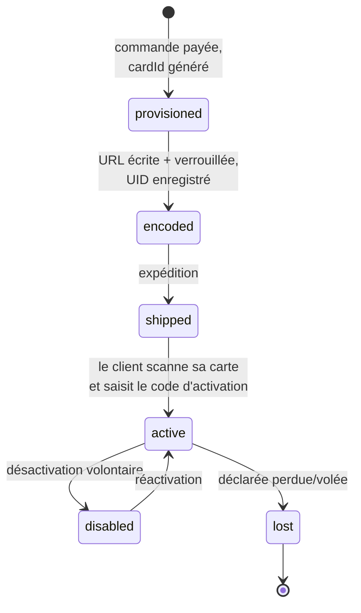
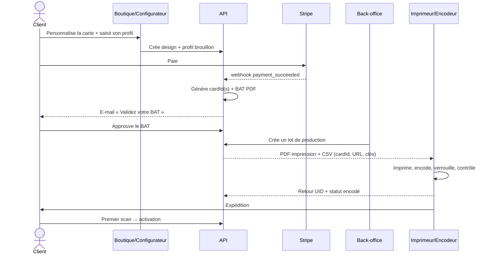
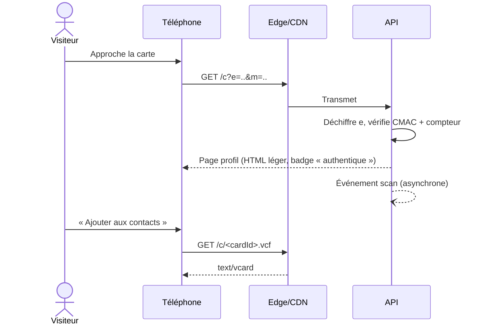

# Architecture — Tapikard, carte de visite imprimée RFID/NFC paramétrable

> **Marque** : **Tapikard** (« tap » + « card », prononçable en français comme en anglais).
> **Domaines** : `tapikard.com` (principal, gravé dans les puces) et `tapikard.fr` (redirection),
> tous deux libres lors de la vérification RDAP du 22/10/2026. À réserver rapidement, après une
> recherche d'antériorité de marque INPI/EUIPO. Alternatives libres en .com et .fr :
> `kontakard`, `vizikarte`, `tapkarte`, `bipkard`.

> Objectif : vendre des cartes de visite physiques, personnalisables (design + données),
> qu'un simple téléphone peut scanner pour afficher les coordonnées du porteur
> et les enregistrer en un geste dans ses contacts.

---

## 1. Choix technologique clé : RFID → **NFC**

Les téléphones ne lisent **pas** la RFID UHF (860–960 MHz) ni la LF (125 kHz).
Ils lisent uniquement la **RFID HF 13,56 MHz au format NFC** (ISO 14443-A, NFC Forum Type 2/4).
La carte doit donc embarquer une **puce NFC** contenant un message **NDEF** de type URL.

| Puce | Mémoire utile | Prix indicatif (puce + inlay, volume) | Usage recommandé |
|---|---|---|---|
| NTAG213 | 144 o | ~0,10–0,30 € | Offre standard : une URL courte suffit |
| NTAG215 / 216 | 504 / 888 o | ~0,20–0,50 € | Si on veut aussi une vCard hors-ligne |
| **NTAG 424 DNA** | 416 o + AES-128 | ~0,80–1,50 € | Offre premium / entreprise : **anti-clonage** (SUN/SDM) |

Compatibilité : tous les Android NFC, et iPhone XS et ultérieurs en **lecture en arrière-plan**
(aucune app à installer : on approche la carte, une notification ouvre l'URL).

### Pourquoi stocker une **URL** et pas directement une vCard ?

| | URL dynamique (recommandé) | vCard dans la puce |
|---|---|---|
| Modifier ses coordonnées après impression | ✅ depuis le tableau de bord | ❌ ré-encodage physique |
| Statistiques de scans | ✅ | ❌ |
| Désactiver une carte perdue | ✅ | ❌ |
| Abonnement / revenus récurrents | ✅ | ❌ |
| Fonctionne sans Internet | ❌ | ✅ |
| Photo, liens, vidéo, formulaire de contact | ✅ | ❌ (mémoire trop petite) |

**Décision** : puce **NTAG 424 DNA** pour toutes les cartes, encodées en interne
(voir le [guide d'encodage](encodage-ntag424.md)). La puce génère `https://tapikard.com/c?e=<…>&m=<…>`, une URL signée et différente à chaque scan ; ; la page servie propose
le bouton « Ajouter aux contacts » (fichier `.vcf` généré à la volée).
Un **QR code** imprimé au verso encode une URL statique `https://tapikard.com/q/<cardId>`
(repli pour les téléphones sans NFC ; elle sert aussi à associer la carte imprimée à la puce lors de l'encodage).

---

## 2. Vue d'ensemble

---

## 3. Composants

### 3.1 La carte physique
- **Support** : PVC (standard), PET recyclé / bois / papier épais avec inlay (éco), **métal**
  (premium — nécessite un inlay avec **ferrite** ou une fenêtre non métallique, sinon la puce ne répond pas).
- **Impression** : recto/verso quadri, sérigraphie, dorure, finition mate/soft-touch.
- **Éléments obligatoires** : pictogramme NFC indiquant où poser le téléphone + QR code de repli.
- **Encodage** : écriture du NDEF URL, puis **verrouillage** (lock bits) pour empêcher toute réécriture
  malveillante. Pour NTAG 424 DNA : configuration SDM avec clé AES propre à chaque carte.

### 3.2 Résolution de scan (le chemin critique)
1. Le téléphone ouvre `https://tapikard.com/c?e=<UID+compteur chiffrés>&m=<CMAC>` (NFC)
   ou `https://tapikard.com/q/<cardId>` (QR).
2. L'API (le CDN se contente de transmettre, car il ne détient pas les clés) :
   - déchiffre `e`, retrouve la carte par son UID, vérifie le CMAC et le compteur anti-rejeu
     ([`tools/sun_verify.py`](../tools/sun_verify.py)) ;
   - résout `carte → profil` (cache Redis/KV invalidé à chaque modification) ;
   - enregistre un événement de scan de façon asynchrone (ne bloque jamais l'affichage) ;
   - sert la page profil.
3. Selon l'état de la carte :
   - `non_activée` → page « Activez votre carte » (pour le propriétaire) ;
   - `active` → profil ;
   - `désactivée` / `perdue` → page neutre sans donnée personnelle.

Exigence : **affichage < 1 s en 4G**, page légère, aucune app requise.

### 3.3 Page profil publique
- Photo, nom, poste, entreprise, téléphones, e-mail, site, adresse, réseaux sociaux, liens libres.
- Bouton **« Ajouter aux contacts »** → `GET /c/<cardId>.vcf` (vCard 3.0 pour compatibilité iOS/Android, photo en base64).
- Boutons d'action : appeler, WhatsApp, e-mail, itinéraire, prendre RDV (Calendly…).
- **Échange de contact** (option Pro) : formulaire où le visiteur laisse ses coordonnées → lead envoyé au porteur.
- Thème aux couleurs de la carte (cohérence physique ↔ numérique).
- Ajout à **Apple Wallet / Google Wallet** (évolution).

### 3.4 Boutique + configurateur (le cœur du business « carte paramétrable »)
- Choix du support, finition, quantité, type de puce (standard/sécurisée).
- Éditeur visuel recto/verso : modèles, import logo, couleurs, polices, placement QR et logo NFC.
- Saisie des données du profil dès la commande (pré-remplit le profil en ligne).
- Génération d'un **BAT** (PDF vectoriel avec fonds perdus, CMJN) validé par le client.
- Commande **B2B en lot** : import CSV des collaborateurs → une carte et un profil par personne.
- Paiement Stripe (carte, SEPA, facture pour B2B), codes promo.

### 3.5 Espace client (tableau de bord)
- Édition du profil en temps réel (aucune réimpression nécessaire).
- Gestion des cartes : activer, renommer, désactiver (perte/vol), associer une carte à un autre profil.
- Multi-profils (pro / perso) et changement du profil actif d'une carte.
- Statistiques : nombre de scans, ajouts aux contacts, clics par lien, géographie approximative (pays/ville).
- Leads collectés + export CSV / synchro CRM (HubSpot, Salesforce, Pipedrive) via webhooks.
- **Espace équipe** (entreprise) : admin, charte graphique verrouillée, champs imposés
  (logo, adresse siège), ajout/retrait de collaborateurs, réattribution d'une carte au départ d'un salarié.

### 3.6 Back-office & production
- File des commandes : `payée → BAT validé → en production → encodée → expédiée → livrée`.
- Génération du **lot de production** pour l'imprimeur : PDF d'impression + CSV
  (`numéro de série, URL à encoder, [clé AES]`).
- Encodage :
  **en interne** (décision prise) : poste dédié avec lecteur USB ACR1252U et douchette QR.
    Le script lit le QR (`cardId`), configure SUN, change les clés, vérifie, puis renvoie
    `UID ↔ cardId` à l'API. Voir le [guide d'encodage NTAG 424](encodage-ntag424.md).
- Contrôle qualité : scan de chaque carte (ou échantillon) → statut `encodée_ok`.
- SAV : remplacement de carte, ré-attribution.

### 3.7 API backend
REST (ou tRPC/GraphQL) authentifiée, principaux domaines :

| Domaine | Exemples d'endpoints |
|---|---|
| Public | `GET /c/:cardId`, `GET /c/:cardId.vcf`, `POST /c/:cardId/lead` |
| Profils | `GET/PUT /profiles/:id`, `POST /profiles/:id/avatar` |
| Cartes | `POST /cards/activate` (code d'activation), `PATCH /cards/:id` (statut, profil lié) |
| Commandes | `POST /orders`, `POST /orders/:id/proof/approve`, webhooks Stripe |
| Production | `POST /batches`, `POST /cards/:id/encoded` (UID, contrôle) |
| Équipes | `POST /orgs/:id/members/import` (CSV), `PUT /orgs/:id/branding` |
| Analytics | `GET /profiles/:id/stats?from&to` |
| Intégrations | webhooks sortants `lead.created`, `card.scanned` |

---

## 4. Modèle de données

Points d'attention :
- Le `cardId` public est **aléatoire et non séquentiel** (≥ 7 caractères base62) pour éviter l'énumération des profils.
- Une carte et un profil sont **découplés** : on peut réaffecter une carte sans la réimprimer.

---

## 5. Cycle de vie d'une carte

L'**activation** (code imprimé sur l'encart d'emballage, ou compte déjà lié à la commande)
empêche qu'une carte interceptée pendant le transport soit associée à un autre compte.

---

## 6. Parcours clés

### 6.1 Commande → réception

### 6.2 Scan par un tiers

---

## 7. Sécurité & conformité (RGPD)

| Risque | Mesure |
|---|---|
| Réécriture de la puce par un tiers | Écriture et configuration réservées à la clé 0, diversifiée par carte |
| Clonage de carte (copie de l'URL) | NTAG 424 DNA + SUN (sur toutes les cartes) : URL unique à chaque scan, CMAC vérifié serveur, compteur anti-rejeu |
| Énumération des profils | `cardId` aléatoire, rate-limiting par IP, profils non indexés (`noindex`) par défaut |
| Carte perdue/volée | Désactivation instantanée depuis l'espace client |
| Fuite des clés AES | Clés chiffrées par KMS, jamais en clair dans la base ni les logs ; diversification par carte |
| Données personnelles | Hébergement UE, consentement explicite du porteur sur chaque champ publié, droit à l'effacement, DPA pour les clients B2B |
| Analytics des visiteurs | Pas de cookie de traçage ; IP tronquée/hachée, seulement pays/ville et type d'appareil ; durée de conservation limitée |
| Leads collectés | Consentement du visiteur sur le formulaire, mention d'information RGPD |
| Comptes | Auth par lien magique / OAuth, 2FA pour les admins d'organisation, rôles (owner, admin, member) |

---

## 8. Stack technique proposée

| Couche | Choix | Raison |
|---|---|---|
| Front (profil public, boutique, dashboard) | **Next.js** (React, SSR/ISR) | Une seule base de code, pages profil ultra-rapides |
| Configurateur de carte | Canvas (Fabric.js / Konva) → export PDF vectoriel (pdf-lib / service de rendu) | Édition WYSIWYG, sortie imprimeur |
| API | Node.js / TypeScript (NestJS ou routes Next.js au MVP) | Productivité, typage partagé front/back |
| Base de données | PostgreSQL (Supabase / Neon / Scaleway) | Relationnel, robuste |
| Cache & redirection | Cloudflare Workers + KV (ou Redis) | Résolution de scan au plus près de l'utilisateur |
| Stockage | S3 compatible (photos, logos, BAT) | Standard |
| Analytics | Table d'événements Postgres au départ, puis ClickHouse | Coût faible au démarrage, scalable |
| Paiement | Stripe (Checkout + Billing pour les abonnements) | Hardware + récurrent dans un seul outil |
| E-mail | SMTP (boîte mail Hostinger, via nodemailer) | Transactionnel, sans service tiers |
| Encodage | Poste dédié + ACR1252U + script Python (`pyscard`) | Encodage NTAG 424 en interne |
| Secrets SUN | KMS (Scaleway / AWS) ou Vault | 3 clés maîtres, jamais dans le code |
| Hébergement | UE (Scaleway, OVH, ou Vercel/AWS région Paris/Francfort) | RGPD |
| Observabilité | Sentry + logs structurés + uptime monitoring de `/c/*` | La page de scan est le produit |

---

## 9. Modèle économique (lié à l'architecture)

Positionnement inspiré de vkard.io (carte prête à l'emploi + cartes personnalisées + récupération des contacts).

| Offre | Contenu | Prix indicatif |
|---|---|---|
| **Carte Basic** | Prête à l'emploi, design Tapikard noir ou blanc, NFC NTAG 424 + QR code, sans BAT. Vendue en ligne ou en stock (salons, revendeurs), activée par le client avec le code de l'encart | 19 € / carte |
| **Carte personnalisée** | Logo, couleurs, informations imprimées ; PVC, bambou ou métal ; BAT à valider | 24–69 € / carte |
| **Profil en ligne** | Inclus à vie : profil modifiable, vCard, statistiques, échange de coordonnées, notification email, export CSV, webhook CRM | Gratuit |
| **Pro** (à venir) | Multi-profils d'équipe, tags et attribution de prospects, signatures email, scanner de cartes papier | ~3 € / profil / mois |
| **Entreprise** | Charte imposée, gestion centralisée, import CSV, SSO, facturation | Sur devis |

**Récupération des contacts (échange de coordonnées)** : après avoir enregistré le contact du porteur, le visiteur se voit proposer de laisser le sien (formulaire pré-rempli par le navigateur, consentement RGPD explicite). Le porteur est prévenu par email avec la fiche .vcf du prospect, le visiteur reçoit la fiche du porteur, et le contact est envoyé au CRM du porteur via webhook (Zapier, Make, n8n → HubSpot, Pipedrive, Google Sheets…).

Coûts unitaires (ordre de grandeur en volume) : carte PVC imprimée avec puce NTAG 424 DNA ≈ 1,50–3 € ;
la marge vient de la carte, puis de l'abonnement Pro et des offres équipes, rendus possibles par l'**URL dynamique**.

## 10. Feuille de route

| Phase | Périmètre |
|---|---|
| **MVP (2–3 mois)** | Modèles de carte fixes + personnalisation texte/logo, NTAG 424 + SUN, QR, page profil + vCard, espace client (édition, activation, désactivation), Stripe, encodage interne, un imprimeur partenaire |
| **V2** | Configurateur visuel complet, abonnement Pro (stats, leads), multi-profils, Apple/Google Wallet, supports bois/métal |
| **V3** | Offre Entreprise (organisations, CSV, SSO, CRM), API publique & webhooks, marque blanche pour revendeurs |

---

## 11. Décisions

| Sujet | Décision |
|---|---|
| Marque / domaine | **Tapikard** : `tapikard.com` (dans les puces, à ne **jamais** laisser expirer) + `tapikard.fr` |
| Puce | **NTAG 424 DNA** + SUN sur toutes les cartes |
| Encodage | **En interne**, voir le [guide](encodage-ntag424.md) |
| Profil de base | Gratuit à vie, inclus dans le prix de la carte (recommandé) |
