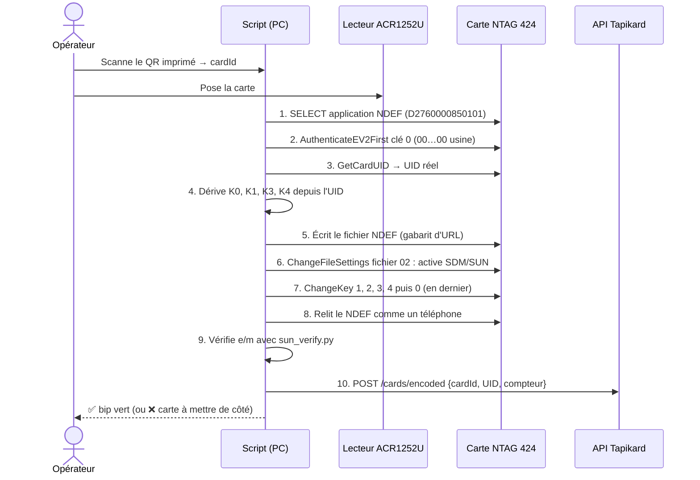

# Guide d'encodage des cartes NTAG 424 DNA (en interne)

> Pour : encoder soi-même les cartes Tapikard livrées vierges par l'imprimeur, avec
> **SUN** (Secure Unique NFC) : à chaque scan, la carte génère une URL unique signée.
> Une copie de la carte ou de l'URL est donc détectée par le serveur.

---

## 1. Principe en une minute

À chaque scan, la puce produit elle-même une URL de ce type :

```
https://tapikard.com/c?e=EF963FF7828658A599F3041510671E88&m=94EED9EE65337086
                         └── e : UID + compteur, chiffrés     └── m : signature (CMAC)
```

- **`e`** contient l'UID de la puce et un **compteur** incrémenté à chaque lecture, chiffrés en AES-128.
- **`m`** est une signature calculée par la puce avec une clé **secrète propre à chaque carte**.
- Le serveur déchiffre `e`, recalcule `m` puis vérifie que le compteur a augmenté. On détecte ainsi :
  - une **URL falsifiée** (signature invalide) ;
  - une **URL recopiée** et rejouée (compteur déjà vu) ;
  - une **puce clonée** : c'est impossible sans la clé, qui ne peut pas être extraite de la puce.

Le code serveur correspondant se trouve dans [`tools/sun_verify.py`](../tools/sun_verify.py).
Il est validé avec le vecteur de test officiel NXP (AN12196) : `python3 tools/sun_verify.py`.

---

## 2. Matériel (≈ 100 €)

| Élément | Recommandation | Prix indicatif |
|---|---|---|
| Lecteur/encodeur NFC USB (PC/SC) | **ACR122U** (ACS ou GOTOP) — ou ACS ACR1252U, plus récent | 30–50 € |
| Douchette QR USB (facultative) | n'importe quel modèle 2D en « émulation clavier » ; sinon on tape l'identifiant ou on utilise le mode `--lot` | 20–40 € |
| Ordinateur | Mac (ou Linux/Windows) avec Python 3.9+ ; idéalement dédié, disque chiffré (FileVault) | — |
| Cartes | Imprimées par l'imprimeur avec inlay **NTAG 424 DNA** vierge (clés d'usine) | — |

À demander à l'imprimeur :
- puce **NTAG 424 DNA** (la version « TagTamper » est inutile), **non encodée**, clés d'usine ;
- **impression de données variables** : un QR code différent par carte, à partir de votre CSV
  (`https://tapikard.com/q/<cardId>`). C'est ce QR qui relie la carte imprimée à la commande ;
- inlay placé loin des zones métalliques (dorure, carte métal → ferrite obligatoire).

---

## 3. Les clés : le point le plus important

La puce possède 5 clés AES-128 (n° 0 à 4). En sortie d'usine, elles valent toutes `00…00`.

| N° | Rôle | Valeur que vous y mettez |
|---|---|---|
| 0 | Clé maître de l'application (permet de reconfigurer la carte) | `diversify(MASTER_K0, UID, 0)` — propre à chaque carte |
| 1 | **SDMFileRead** : calcule la signature `m` | `diversify(MASTER_K1, UID, 1)` — propre à chaque carte |
| 2 | **SDMMetaRead** : chiffre `e` (UID + compteur) | `K_META` — **commune** à toutes les cartes (le serveur doit déchiffrer `e` pour connaître l'UID) |
| 3, 4 | Inutilisées | diversifiées aussi (pour ne pas laisser de clé d'usine) |

« Diversifier » une clé consiste à la dériver de la clé maître et de l'UID, selon la méthode de NXP AN10922
(`diversify_key()` dans `tools/sun_verify.py`). Vous ne stockez donc **que 3 secrets** :
`MASTER_K0`, `MASTER_K1` et `K_META`. Aucune clé n'est stockée carte par carte.

Règles de sécurité :
1. Générez les 3 secrets avec un vrai générateur aléatoire : `python3 -c "import secrets;print(secrets.token_hex(16))"`.
2. Conservez-les dans un gestionnaire de secrets (KMS, Vault, ou à défaut un gestionnaire de mots de passe),
   **plus une copie papier dans un coffre**. Si vous les perdez, toutes les cartes déjà vendues deviennent
   invérifiables et ne peuvent plus être reconfigurées.
3. Ils ne doivent exister que sur le poste d'encodage et sur le serveur de vérification.
   Jamais dans le code source, dans git ou dans le front.

---

## 4. Ce que le script d'encodage fait, carte par carte

Comptez quelques secondes par carte. Les commandes sont décrites avec des exemples octet par octet
dans **NXP AN12196** (« NTAG 424 DNA features and hints »), qui sert de référence pour coder le script.



### Détail des étapes

**5. Gabarit d'URL écrit dans le fichier NDEF (fichier 02)**, avec des zéros à la place des valeurs dynamiques :

```
https://tapikard.com/c?e=00000000000000000000000000000000&m=0000000000000000
```

**6. Réglages SDM (ChangeFileSettings du fichier 02)**

| Paramètre | Valeur | Signification |
|---|---|---|
| FileOption | SDM activé, communication « plain » | La carte réécrit l'URL à chaque lecture |
| Droits d'accès | Lecture = libre (E), Écriture / LectureÉcriture / Changement = clé 0 | Tout le monde peut lire, seul vous pouvez modifier |
| SDMOptions | Miroir UID + miroir compteur, encodage ASCII | `e` contient UID + compteur, en hexadécimal |
| SDMMetaRead | clé 2 | `e` est chiffré avec `K_META` |
| SDMFileRead | clé 1 | `m` est signé avec la clé diversifiée de la carte |
| SDMCtrRet | F (désactivé) | Le compteur n'est pas lisible en clair |
| PICCDataOffset | position du 1er `0` après `e=` | Où la puce écrit `e` |
| SDMMACInputOffset = SDMMACOffset | position du 1er `0` après `m=` | Signature calculée sur une entrée vide (ce que vérifie `sun_verify.py`) |

**7. Changement des clés** : les clés 1 à 4 d'abord, en restant authentifié avec la clé 0 d'usine.
La clé 0 se change **en dernier**, car la session d'authentification se termine à ce moment-là.

**8–9. Contrôle qualité** : relisez la carte sans authentification, comme le ferait un téléphone,
puis vérifiez `e`/`m`. Une carte qui échoue ne part pas en expédition.
Faites aussi un test réel avec un iPhone et un Android sur les premières cartes de chaque lot.

---

## 5. Le script d'encodage (`tools/encodeur/`)

Le script `encodeur.py` fait toute la séquence de la section 4 et l'enregistre sur le site.
Son protocole est vérifié octet par octet contre les exemples chiffrés de NXP (AN12196),
puis testé de bout en bout sur une carte NTAG 424 émulée (`python3 encodeur.py --test`).

### Installation sur Mac (une seule fois, 10 min)

1. **Branchez le lecteur ACR122U** en USB. macOS le reconnaît sans pilote dans la plupart des cas.
2. Ouvrez le **Terminal** (⌘ + Espace → « Terminal ») et placez-vous dans le dossier du script :
   ```bash
   git clone https://github.com/nico83200/Claude-public.git tapikard   # ou téléchargez le dépôt en zip
   cd tapikard/tools/encodeur
   ```
3. Créez l'environnement Python et installez les deux dépendances :
   ```bash
   python3 -m venv .venv
   source .venv/bin/activate
   python3 -m pip install -r requirements.txt
   ```
   Si `python3` est introuvable, macOS propose d'installer les « outils de ligne de commande » : acceptez.
4. Vérifiez que le lecteur est vu :
   ```bash
   python3 encodeur.py --lecteurs        # doit afficher « ACS ACR122U PICC Interface » ou similaire
   python3 encodeur.py --test            # 14 tests, tous « ok »
   ```
5. Créez la configuration :
   ```bash
   cp encodeur.env.example encodeur.env
   open -e encodeur.env
   ```
   Renseignez `TAPIKARD_URL` (votre site, **gravé à vie dans les puces**), `ENCODING_API_KEY`, `SUN_K_META` et
   `SUN_MASTER_K1` (**les mêmes valeurs que sur Hostinger**), et générez `SUN_MASTER_K0` avec `openssl rand -hex 16`.
   Ce fichier ne doit jamais être envoyé sur GitHub (il est ignoré par git).

À chaque nouvelle session de Terminal : `cd tapikard/tools/encodeur && source .venv/bin/activate`.

### Encoder un lot

1. Back-office → **Production & encodage** → créez le lot → **CSV**, enregistrez-le (ex. dans Téléchargements).
2. Lancez :
   ```bash
   python3 encodeur.py --lot ~/Downloads/LOT-20261022-ABCD.csv
   ```
3. Le script affiche la carte attendue (« Posez la carte **Ab3dE5gH7j** ») : posez la carte imprimée **dont le QR code
   porte cet identifiant**, attendez le ✓ vert (2 à 3 secondes), retirez-la, passez à la suivante.

Sans CSV, `python3 encodeur.py` demande l'identifiant de chaque carte : scannez son QR code avec une douchette
(ou tapez l'identifiant imprimé), puis posez la carte.

Pour chaque carte, le script :
- écrit l'URL, configure SUN, installe les 5 clés (section 4) ;
- relit la carte comme un téléphone et vérifie la signature ;
- l'enregistre sur le site (`POST /api/encodage`) ;
- **rejoue le scan auprès du site** : si le site ne reconnaît pas la signature (clés différentes entre le poste et
  Hostinger), le script s'arrête immédiatement, pour ne pas produire une série de cartes inutilisables ;
- note le résultat dans `encodage-journal.csv`.

Une carte en échec peut être reposée et relancée sans risque : le script reprend une carte partiellement
configurée (par exemple retirée trop tôt) avec ses clés Tapikard.

### Vérifier une carte

```bash
python3 encodeur.py --verifier
```
Lit les cartes posées sur le lecteur sans les modifier et indique si leur signature est valide, avec l'UID et le compteur.

### Encoder avec un téléphone Android (sans ordinateur)

Le téléphone remplace le lecteur USB. Il ne connaît aucune clé : le site calcule chaque commande NTAG 424 et le
téléphone se contente de la transmettre à la carte, puis de renvoyer la réponse. Les clés restent sur Hostinger.

**Une seule fois :**
1. Sur Hostinger, ajoutez la variable `SUN_MASTER_K0` avec **la même valeur que dans `encodeur.env`** du poste
   (voir `deploy/HOSTINGER.md`), puis redéployez. Sans elle, la page d'encodage l'indique et reste inactive.
2. Sur le téléphone (Android 8 ou plus récent, avec NFC), ouvrez `https://<votre site>/encodage` dans Chrome et
   touchez **Télécharger l'application**. Ouvrez le fichier `tapikard-encodeur.apk` et autorisez l'installation
   (« Installer des applications inconnues » pour Chrome). Si Play Protect affiche un avertissement, choisissez
   **Installer quand même** : l'application n'est pas sur le Play Store.
3. Ouvrez **Tapikard Encodeur** et connectez-vous avec votre email d'administrateur : saisissez le **code à
   6 chiffres** reçu par email (le lien de l'email s'ouvrirait dans Chrome, pas dans l'application).
   La connexion est conservée 30 jours.

**Encoder un lot :**
1. Créez le lot dans Back-office → Production, comme d'habitude.
2. Dans l'application, choisissez le lot. Elle affiche la carte attendue (« Ab3dE5gH7j ») : posez au dos du
   téléphone la carte imprimée **dont le QR code porte cet identifiant**. La zone NFC est en général au centre du dos,
   près de l'appareil photo.
3. Gardez la carte immobile jusqu'au ✓ et à la vibration (2 à 4 secondes selon le réseau), retirez-la, posez la suivante.

Le site vérifie lui-même la signature produite par la carte avant de l'enregistrer : une carte marquée ✓ est
prête à être expédiée. **Vérifier une carte** lit une carte sans la modifier (UID, compteur, carte associée).

En cas d'échec (carte retirée trop tôt, réseau coupé), touchez **Réessayer** : la carte est reprise là où elle s'était
arrêtée. Le téléphone a besoin d'Internet pendant l'encodage (Wi-Fi conseillé).

### Dépannage

| Symptôme | Solution |
|---|---|
| `Aucun lecteur détecté` | Débranchez/rebranchez le lecteur (sans hub USB si possible). Si le problème persiste, installez le pilote macOS « ACR122U » depuis le site d'ACS (acs.com.hk → Support → Drivers), puis redémarrez |
| `pyscard n'est pas installé` | Activez l'environnement (`source .venv/bin/activate`) puis `python3 -m pip install -r requirements.txt`. Si l'installation de pyscard échoue : `brew install swig` puis recommencez |
| Le lecteur bipe mais le script attend toujours | Certains clones d'ACR122U gèrent mal les cartes ISO 14443-4. Essayez `python3 encodeur.py --verifier` avec une carte NTAG 424 ; en cas d'erreur `6300`/`6A81`, utilisez un lecteur ACS d'origine (ACR122U ou ACR1252U) |
| `carte non compatible : UID de 4 octets` (ex. 8A30CB4A) | Ce n'est pas une NTAG 424 DNA mais probablement une MIFARE Classic, souvent livrée avec les lecteurs ACR122U : illisible par les iPhone et sans signature. Commandez des cartes NTAG 424 DNA (UID de 7 octets commençant par 04) |
| `erreur d'authentification` sur une carte neuve | La carte n'est pas une NTAG 424 DNA vierge (vérifiez avec l'app NXP TagInfo) ou elle a été configurée ailleurs |
| `CERTIFICATE_VERIFY_FAILED` | Python installé depuis python.org : lancez « Install Certificates.command » dans le dossier Applications/Python 3.x |
| `Le site ne reconnaît pas la signature` | `SUN_K_META` / `SUN_MASTER_K1` du poste différentes de celles de Hostinger : corrigez avant de continuer |
| Application Android : « Carte non compatible » | Même cause que l'UID de 4 octets ci-dessus : ce n'est pas une NTAG 424 DNA |
| Application Android : « Encodage mobile indisponible » | Ajoutez `SUN_MASTER_K0` (même valeur que dans `encodeur.env`) aux variables Hostinger et redéployez |
| Application Android : la carte n'est pas détectée | Activez le NFC (Réglages → Appareils connectés), retirez la coque si elle est épaisse ou métallique, et cherchez la zone NFC en déplaçant lentement la carte au dos du téléphone |
| Carte encodée sans connexion Internet | `python3 encodeur.py --hors-ligne`, puis saisissez l'UID (journal) dans le back-office → Production → « Saisie manuelle » |

## 6. Côté serveur

- La route `GET /c?e=…&m=…` est traitée par l'**API**, pas par le CDN, car c'est elle qui détient les clés.
  Le CDN se contente de transmettre.
- Algorithme (voir `verify_scan()`) :
  1. déchiffrer `e` avec `K_META` pour obtenir l'UID et le compteur ;
  2. retrouver la carte par son UID en base ;
  3. dériver `K1 = diversify(MASTER_K1, UID, 1)` et recalculer la signature, puis la comparer à `m` ;
  4. exiger `compteur > dernier_compteur` et enregistrer le nouveau compteur ;
  5. si tout est valide, afficher le profil.
- Si la vérification échoue, n'affichez pas d'erreur alarmante au visiteur :
  affichez le profil avec un badge « non vérifié » ou une page neutre, et alertez le propriétaire.
- Le QR imprimé (`/q/<cardId>`) est statique, donc copiable. Il affiche le profil, mais seul
  le scan NFC donne le badge **« carte authentique »**.

---

## 7. Check-list avant la première production

- [ ] Domaines `tapikard.com` et `tapikard.fr` achetés, en **renouvellement automatique** sur 10 ans
- [ ] Marque « Tapikard » vérifiée et déposée (INPI / EUIPO, classes 16, 35, 42)
- [ ] 3 secrets générés, sauvegardés en double (coffre numérique + papier)
- [ ] `python3 encodeur.py --test` : tous les tests « ok »
- [ ] 3 à 5 cartes de test encodées avec le script, puis scannées avec un iPhone et un Android (badge « Carte authentique »)
- [ ] `SUN_MASTER_K0` sauvegardée avec les deux autres clés
- [ ] CSV `cardId → URL QR` transmis à l'imprimeur, BAT du QR validé
