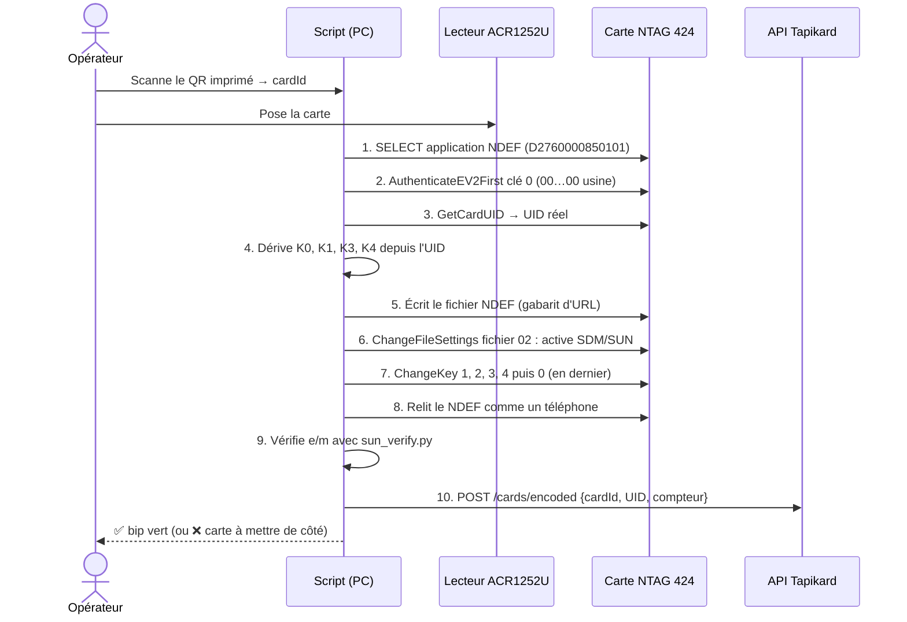

# Guide d'encodage des cartes NTAG 424 DNA (en interne)

> Pour : encoder soi-même les cartes Tapikard livrées vierges par l'imprimeur, avec
> **SUN** (Secure Unique NFC) : à chaque scan, la carte génère une URL unique signée.
> Une copie de la carte ou de l'URL est donc détectée par le serveur.

---

## 1. Principe en une minute

À chaque scan, la puce produit elle-même une URL de ce type :

```
https://tapikard.com/c?e=EF963FF7828658A599F3041510671E88&m=94EED9EE65337086
                         └── e : UID + compteur, chiffrés     └── m : signature (CMAC)
```

- **`e`** contient l'UID de la puce et un **compteur** incrémenté à chaque lecture, chiffrés en AES-128.
- **`m`** est une signature calculée par la puce avec une clé **secrète propre à chaque carte**.
- Le serveur déchiffre `e`, recalcule `m` puis vérifie que le compteur a augmenté. On détecte ainsi :
  - une **URL falsifiée** (signature invalide) ;
  - une **URL recopiée** et rejouée (compteur déjà vu) ;
  - une **puce clonée** : c'est impossible sans la clé, qui ne peut pas être extraite de la puce.

Le code serveur correspondant se trouve dans [`tools/sun_verify.py`](../tools/sun_verify.py).
Il est validé avec le vecteur de test officiel NXP (AN12196) : `python3 tools/sun_verify.py`.

---

## 2. Matériel (≈ 100 €)

| Élément | Recommandation | Prix indicatif |
|---|---|---|
| Lecteur/encodeur NFC USB (PC/SC) | **ACS ACR1252U** (ou Identiv uTrust 3700 F) | 35–50 € |
| Douchette QR USB | n'importe quel modèle 2D en « émulation clavier » | 20–40 € |
| Ordinateur | Linux, macOS ou Windows avec Python 3 ; **dédié**, chiffré, sans autre usage | — |
| Cartes | Imprimées par l'imprimeur avec inlay **NTAG 424 DNA** vierge (clés d'usine) | — |

À demander à l'imprimeur :
- puce **NTAG 424 DNA** (la version « TagTamper » est inutile), **non encodée**, clés d'usine ;
- **impression de données variables** : un QR code différent par carte, à partir de votre CSV
  (`https://tapikard.com/q/<cardId>`). C'est ce QR qui relie la carte imprimée à la commande ;
- inlay placé loin des zones métalliques (dorure, carte métal → ferrite obligatoire).

---

## 3. Les clés : le point le plus important

La puce possède 5 clés AES-128 (n° 0 à 4). En sortie d'usine, elles valent toutes `00…00`.

| N° | Rôle | Valeur que vous y mettez |
|---|---|---|
| 0 | Clé maître de l'application (permet de reconfigurer la carte) | `diversify(MASTER_K0, UID, 0)` — propre à chaque carte |
| 1 | **SDMFileRead** : calcule la signature `m` | `diversify(MASTER_K1, UID, 1)` — propre à chaque carte |
| 2 | **SDMMetaRead** : chiffre `e` (UID + compteur) | `K_META` — **commune** à toutes les cartes (le serveur doit déchiffrer `e` pour connaître l'UID) |
| 3, 4 | Inutilisées | diversifiées aussi (pour ne pas laisser de clé d'usine) |

« Diversifier » une clé consiste à la dériver de la clé maître et de l'UID, selon la méthode de NXP AN10922
(`diversify_key()` dans `tools/sun_verify.py`). Vous ne stockez donc **que 3 secrets** :
`MASTER_K0`, `MASTER_K1` et `K_META`. Aucune clé n'est stockée carte par carte.

Règles de sécurité :
1. Générez les 3 secrets avec un vrai générateur aléatoire : `python3 -c "import secrets;print(secrets.token_hex(16))"`.
2. Conservez-les dans un gestionnaire de secrets (KMS, Vault, ou à défaut un gestionnaire de mots de passe),
   **plus une copie papier dans un coffre**. Si vous les perdez, toutes les cartes déjà vendues deviennent
   invérifiables et ne peuvent plus être reconfigurées.
3. Ils ne doivent exister que sur le poste d'encodage et sur le serveur de vérification.
   Jamais dans le code source, dans git ou dans le front.

---

## 4. Ce que le script d'encodage fait, carte par carte

Comptez quelques secondes par carte. Les commandes sont décrites avec des exemples octet par octet
dans **NXP AN12196** (« NTAG 424 DNA features and hints »), qui sert de référence pour coder le script.



### Détail des étapes

**5. Gabarit d'URL écrit dans le fichier NDEF (fichier 02)**, avec des zéros à la place des valeurs dynamiques :

```
https://tapikard.com/c?e=00000000000000000000000000000000&m=0000000000000000
```

**6. Réglages SDM (ChangeFileSettings du fichier 02)**

| Paramètre | Valeur | Signification |
|---|---|---|
| FileOption | SDM activé, communication « plain » | La carte réécrit l'URL à chaque lecture |
| Droits d'accès | Lecture = libre (E), Écriture / LectureÉcriture / Changement = clé 0 | Tout le monde peut lire, seul vous pouvez modifier |
| SDMOptions | Miroir UID + miroir compteur, encodage ASCII | `e` contient UID + compteur, en hexadécimal |
| SDMMetaRead | clé 2 | `e` est chiffré avec `K_META` |
| SDMFileRead | clé 1 | `m` est signé avec la clé diversifiée de la carte |
| SDMCtrRet | F (désactivé) | Le compteur n'est pas lisible en clair |
| PICCDataOffset | position du 1er `0` après `e=` | Où la puce écrit `e` |
| SDMMACInputOffset = SDMMACOffset | position du 1er `0` après `m=` | Signature calculée sur une entrée vide (ce que vérifie `sun_verify.py`) |

**7. Changement des clés** : les clés 1 à 4 d'abord, en restant authentifié avec la clé 0 d'usine.
La clé 0 se change **en dernier**, car la session d'authentification se termine à ce moment-là.

**8–9. Contrôle qualité** : relisez la carte sans authentification, comme le ferait un téléphone,
puis vérifiez `e`/`m`. Une carte qui échoue ne part pas en expédition.
Faites aussi un test réel avec un iPhone et un Android sur les premières cartes de chaque lot.

---

## 5. Mise en route progressive

| Étape | Outil | Objectif |
|---|---|---|
| 1. Découverte (5–10 cartes de test) | **NXP TagXplorer** (logiciel PC gratuit, compte NXP) + ACR1252U | Configurer SUN à la main pour comprendre chaque réglage ; lire la carte avec l'app **NXP TagInfo** |
| 2. Vérification | `tools/sun_verify.py` + scan au téléphone | Vérifier que le serveur accepte les URL générées |
| 3. Production | Script Python (`pyscard`) qui automatise la section 4 | Encodage en série, liaison QR ↔ UID, appel de l'API |

Le projet open source **sdm-backend** de nfc-developer sur GitHub est une bonne source d'inspiration
pour la vérification SUN. Les outils de la communauté « Bolt Card », qui programment des NTAG 424 en
SUN, peuvent servir de référence pour le script d'encodage. Vérifiez la licence avant de réutiliser du code.

---

## 6. Côté serveur

- La route `GET /c?e=…&m=…` est traitée par l'**API**, pas par le CDN, car c'est elle qui détient les clés.
  Le CDN se contente de transmettre.
- Algorithme (voir `verify_scan()`) :
  1. déchiffrer `e` avec `K_META` pour obtenir l'UID et le compteur ;
  2. retrouver la carte par son UID en base ;
  3. dériver `K1 = diversify(MASTER_K1, UID, 1)` et recalculer la signature, puis la comparer à `m` ;
  4. exiger `compteur > dernier_compteur` et enregistrer le nouveau compteur ;
  5. si tout est valide, afficher le profil.
- Si la vérification échoue, n'affichez pas d'erreur alarmante au visiteur :
  affichez le profil avec un badge « non vérifié » ou une page neutre, et alertez le propriétaire.
- Le QR imprimé (`/q/<cardId>`) est statique, donc copiable. Il affiche le profil, mais seul
  le scan NFC donne le badge **« carte authentique »**.

---

## 7. Check-list avant la première production

- [ ] Domaines `tapikard.com` et `tapikard.fr` achetés, en **renouvellement automatique** sur 10 ans
- [ ] Marque « Tapikard » vérifiée et déposée (INPI / EUIPO, classes 16, 35, 42)
- [ ] 3 secrets générés, sauvegardés en double (coffre numérique + papier)
- [ ] 10 cartes de test configurées à la main avec TagXplorer, et vérifiées avec un iPhone et un Android
- [ ] Script d'encodage testé sur 50 cartes, avec 0 échec de vérification
- [ ] CSV `cardId → URL QR` transmis à l'imprimeur, BAT du QR validé
