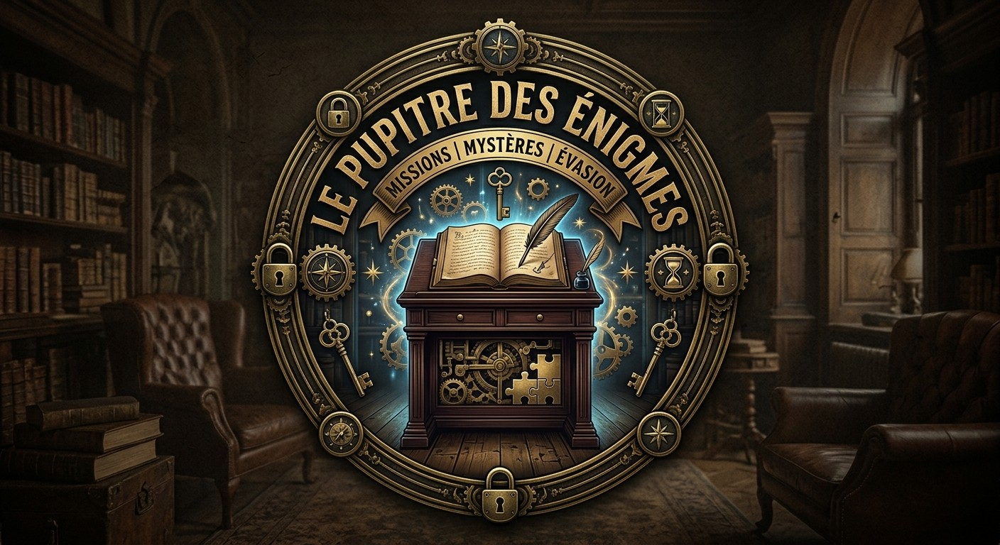

# Le Pupitre des Énigmes



Une console d'escape game de table pour adultes (2 à 6 joueurs), construite
autour d'un ESP32. Elle a un écran, une **fente** où l'on glisse les cartes et un
**lecteur à plat** où l'on pose des objets (puces NFC), un **clavier 4×4**, des
boutons, une molette, un **interrupteur à clé**, un **tableau de 10 voyants**, un
**capteur de couleur**, un ruban lumineux sous la boîte, des voix
pré-enregistrées et un **casque pour les messages privés**. Chaque mission
utilise tout ou partie de ces éléments ; sa façade cache les autres.

Le pupitre est **multi-mondes** : chaque univers se charge en posant sa **carte
Monde** dans la fente, et s'habille d'une **façade aimantée** à son image.

## Les mondes

| Monde | Mission | Difficulté | Durée |
|---|---|---|---|
| 🐴 [Le Haras des Trois Fers](mondes/haras/) | 1 · [La Disparition d'Éclipse](mondes/haras/mission-1-disparition-eclipse.md) · [déroulé](mondes/haras/mission-1-deroule.md) | 🟢 Accessible | 60 min |
| 🎰 [Monte-Carlo 1928](mondes/casse/) | 2 · [Le Casse du Siècle](mondes/casse/mission-2-casse-du-siecle.md) · [déroulé](mondes/casse/mission-2-deroule.md) | 🟠 Intermédiaire | 60 min |
| 🚀 [Station Kepler-9](mondes/kepler/) | 3 · [Signal Perdu](mondes/kepler/mission-3-signal-perdu.md) · [déroulé](mondes/kepler/mission-3-deroule.md) | 🔴 Difficile | 75 min |
| ⚓ [Sous-marin Narval](mondes/narval/) | 4 · [Dernier souffle](mondes/narval/mission-4-dernier-souffle.md) · [déroulé](mondes/narval/mission-4-deroule.md) · *escape game pour adultes, sans rôles* | 🔴 Difficile | 60 min |
| ⚙️ [L'Atelier du professeur Lumen](mondes/atelier/) | 5 · Banc d'essai · [déroulé](mondes/atelier/mission-5-deroule.md) · *la mission de test du pupitre, pour 2 joueurs : chaque organe essayé une fois* | 🟢 Facile | 20 à 30 min |
| 💣 [Brigade de déminage](mondes/deminage/) | 6 · Désamorçage · [déroulé](mondes/deminage/mission-6-deroule.md) · *jeu de communication : un démineur au pupitre, des experts avec le manuel ; 12 bombes tirées au sort* | 🟠 Tendu | 12 min par bombe |
| 🕯️ [Le Manoir Blackwood](mondes/blackwood/) | 7 · [La dernière nuit de Lord Edgar](mondes/blackwood/mission-7-derniere-nuit.md) · [déroulé](mondes/blackwood/mission-7-deroule.md) · *enquête gothique, la lampe à remonter, une séance de spiritisme* | 🟠 Intermédiaire | 60 min |

Les sept missions sont complètes : scénario, déroulé, répliques, script de
doublage, matériel à imprimer et **script du pupitre**.

## Le programme

Le [programme de l'ESP32](firmware/) exécute les missions sous forme de scripts
JSON rangés sur la carte SD de l'écran : on ajoute un monde sans reflasher la
console. Un simulateur rejoue des parties complètes sur ordinateur pour vérifier
chaque mission.

```
cd firmware && pio run -t upload                  # téléverser dans l'ESP32
python3 outils/preparer_sd.py --sortie /media/SD  # préparer la carte SD de l'écran
sh firmware/test/lancer.sh                        # rejouer les parties de test
```

Voir [firmware/README.md](firmware/README.md) (installation, enregistrement des
cartes, réglages) et [firmware/SCRIPTS.md](firmware/SCRIPTS.md) (écrire une
mission).

## Le dépôt

| Dossier | Contenu |
|---|---|
| [`console/`](console/) | Le matériel, le câblage, l'organisation des cartes SD, les sons et la voix du pupitre |
| [`mondes/`](mondes/) | Un dossier par monde : scénarios, déroulés, répliques, documents à imprimer |
| [`firmware/`](firmware/) | Le programme de l'ESP32, le simulateur PC et le langage des scripts |
| [`outils/`](outils/) | Génération des voix (ElevenLabs), fabrication des PDF, préparation et vérification de la carte SD |
| [`pdf/`](pdf/) | Les documents prêts à imprimer |

## Les documents à imprimer

Tous les PDF sont dans [`pdf/`](pdf/) et se régénèrent avec
`python3 outils/impression/construire.py` (ou `construire.py 2` pour une seule
mission).

| Commun | Pour qui |
|---|---|
| [Mode d'emploi du pupitre](pdf/mode-emploi.pdf) | Tout le monde, valable pour tous les mondes |
| [Liste d'achat](pdf/liste-achats.pdf) | Le constructeur (source : `console/achats.json`) |
| [Notice de montage](pdf/notice-montage.pdf) | Le constructeur : boîtier, composants, câblage, programme de l'ESP32 et cartes SD |
| [Plan de câblage](pdf/plan-cablage.pdf) | Le constructeur : la plaque de l'ESP32 et la liste numérotée de tous les fils |

**Les livrets A5** (fiche de mission et fiche d'enquête, avec une couverture : description, l'essentiel, nombre de joueurs, durée, difficulté ★ à ★★★). Deux fichiers par mission : `mission-N-livret-a5.pdf` (les pages dans l'ordre, pour l'écran) et `mission-N-livret-a5-brochure.pdf` (à imprimer en **recto verso, retourné sur le bord court**, puis à plier en deux et agrafer au milieu) :
[La Disparition d'Éclipse](pdf/mission-1-livret-a5-brochure.pdf) ★ ·
[Le Casse du Siècle](pdf/mission-2-livret-a5-brochure.pdf) ★★ ·
[Signal Perdu](pdf/mission-3-livret-a5-brochure.pdf) ★★★ ·
[Dernier souffle](pdf/mission-4-livret-a5-brochure.pdf) ★★★ ·
[Banc d'essai](pdf/mission-5-livret-a5-brochure.pdf) ★ ·
[Désamorçage](pdf/mission-6-livret-a5-brochure.pdf) ★★ ·
[La dernière nuit de Lord Edgar](pdf/mission-7-livret-a5-brochure.pdf) ★★

Tous les livrets sont en « édition premium » : 16 pages composées directement en A5 (`mondes/<monde>/impression/livret.html`) sur la feuille de style commune `outils/impression/livret.css`, qui fixe la charte et le chemin de fer : couverture, bienvenue et sommaire, l'histoire, la mission, les personnages, les rôles, les lieux, le pupitre, le carnet à remplir, notes et quatrième de couverture. Chaque monde n'y change que ses couleurs, ses icônes et ses illustrations. Une mission sans `livret.html` retombe sur le livret générique. Une page commune à toutes les missions explique comment lire une carte : [lire-une-carte-a5.pdf](pdf/lire-une-carte-a5.pdf) (à glisser dans la boîte, ou au dos d'un livret).

| Par mission | Mission 1 · Haras | Mission 2 · Monte-Carlo | Mission 3 · Kepler-9 | Mission 4 · Narval |
|---|---|---|---|---|
| **À imprimer en recto seul** (fiche, plateau, documents, enveloppes…) | [PDF](pdf/mission-1-a-imprimer-recto.pdf) | [PDF](pdf/mission-2-a-imprimer-recto.pdf) | [PDF](pdf/mission-3-a-imprimer-recto.pdf) | [PDF](pdf/mission-4-a-imprimer-recto.pdf) |
| **À imprimer en recto verso** (les planches de cartes) | [PDF](pdf/mission-1-a-imprimer-recto-verso.pdf) | [PDF](pdf/mission-2-a-imprimer-recto-verso.pdf) | [PDF](pdf/mission-3-a-imprimer-recto-verso.pdf) | [PDF](pdf/mission-4-a-imprimer-recto-verso.pdf) |
| Fiche de mission (joueurs) | [PDF](pdf/mission-1-fiche-joueurs.pdf) | [PDF](pdf/mission-2-fiche-joueurs.pdf) | [PDF](pdf/mission-3-fiche-joueurs.pdf) | [PDF](pdf/mission-4-fiche-joueurs.pdf) |
| Plateau de la façade | [PDF](pdf/mission-1-plateau.pdf) | — | — | [PDF](pdf/mission-4-plateau.pdf) |
| Cartes recto verso | [PDF](pdf/mission-1-cartes.pdf) | [PDF](pdf/mission-2-cartes.pdf) | [PDF](pdf/mission-3-cartes.pdf) | [PDF](pdf/mission-4-cartes.pdf) |
| Documents secrets des rôles | [PDF](pdf/mission-1-documents-secrets.pdf) | [PDF](pdf/mission-2-documents-secrets.pdf) | [PDF](pdf/mission-3-documents-secrets.pdf) | — (pas de rôles) |
| Enveloppes (contenu et étiquettes) | [PDF](pdf/mission-1-enveloppes.pdf) | [PDF](pdf/mission-2-enveloppes.pdf) | [PDF](pdf/mission-3-enveloppes.pdf) | [PDF](pdf/mission-4-enveloppes.pdf) |
| Fiche d'enquête (notes de l'équipe) | [PDF](pdf/mission-1-fiche-enquete.pdf) | [PDF](pdf/mission-2-fiche-enquete.pdf) | [PDF](pdf/mission-3-fiche-enquete.pdf) | [Carnet de bord](pdf/mission-4-carnet-de-bord.pdf) |
| Déroulé du maître du jeu (solutions) | [PDF](pdf/mission-1-deroule-maitre-du-jeu.pdf) | [PDF](pdf/mission-2-deroule-maitre-du-jeu.pdf) | [PDF](pdf/mission-3-deroule-maitre-du-jeu.pdf) | [PDF](pdf/mission-4-deroule-maitre-du-jeu.pdf) |
| Script de doublage (ElevenLabs) | [PDF](pdf/mission-1-script-doublage.pdf) | [PDF](pdf/mission-2-script-doublage.pdf) | [PDF](pdf/mission-3-script-doublage.pdf) | [PDF](pdf/mission-4-script-doublage.pdf) |

**Mission 5 · Banc d'essai** (test du pupitre) : [à imprimer en recto seul](pdf/mission-5-a-imprimer-recto.pdf) (fiche des joueurs, page du maître du jeu avec les pastilles du nuancier et la fiche de recette, [plan du banc d'essai](pdf/mission-5-plateau.pdf) pour la façade) · [cartes en recto verso](pdf/mission-5-a-imprimer-recto-verso.pdf) · [déroulé](pdf/mission-5-deroule-maitre-du-jeu.pdf) · [script de doublage](pdf/mission-5-script-doublage.pdf)

**Mission 6 · Désamorçage** (2 à 8 joueurs) : [à imprimer en recto seul](pdf/mission-6-a-imprimer-recto.pdf) (fiche du démineur avec les pastilles, [manuel de désamorçage](pdf/mission-6-manuel.pdf) des experts) · [cartes en recto verso](pdf/mission-6-a-imprimer-recto-verso.pdf) · [déroulé et solutions des 12 bombes](pdf/mission-6-deroule-maitre-du-jeu.pdf) · [script de doublage](pdf/mission-6-script-doublage.pdf)

**Mission 7 · La dernière nuit de Lord Edgar** (3 à 8 joueurs) : [à imprimer en recto seul](pdf/mission-7-a-imprimer-recto.pdf) (fiche de mission, documents secrets, enveloppes, fiche d'enquête) · [cartes en recto verso](pdf/mission-7-a-imprimer-recto-verso.pdf) · [déroulé](pdf/mission-7-deroule-maitre-du-jeu.pdf) · [script de doublage](pdf/mission-7-script-doublage.pdf)
