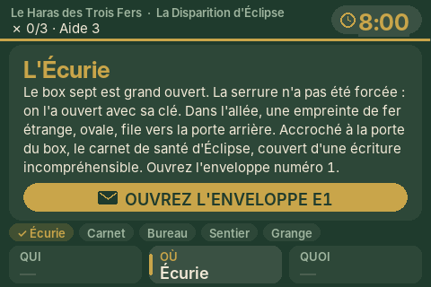
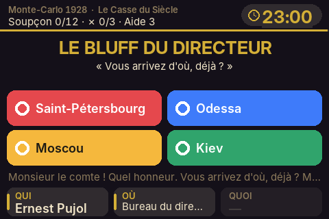
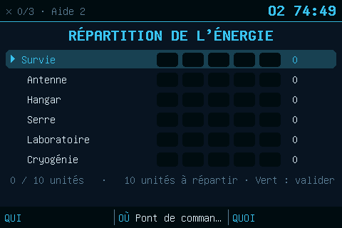

# Le programme du pupitre

Le programme de l'ESP32, et un simulateur qui fait tourner le même moteur sur un
ordinateur.

Le pupitre ne contient **aucune mission en dur**. Il exécute des **scripts JSON**
rangés sur la carte SD de l'écran : ajouter un monde ou corriger une énigme ne
demande pas de reflasher l'ESP32, seulement de recopier la carte SD.

<p>
  
</p>

## Organisation

```
firmware/
├── platformio.ini          la configuration de compilation (PlatformIO)
├── lib/moteur/src/         le moteur de jeu, portable (aucun code Arduino)
│   ├── moteur.h / .cpp     règles, épreuves, imprévus, indices, accusation, sauvegarde
│   ├── expression.h / .cpp les conditions des scripts (« J2 && !J4 », « restant>=15 »…)
│   └── plateforme.h        ce que le moteur attend du matériel
├── src/                    le matériel
│   ├── broches.h           le câblage et les réglages matériels (Wi-Fi, molette, écran)
│   ├── main.cpp            démarrage et boucle principale
│   ├── dessin.cpp          les écrans (commun au pupitre et au simulateur)
│   ├── ecran.cpp           l'ILI9488 sur le bus SPI
│   ├── lecteurs.cpp        les 2 lecteurs RFID RC522 (fente, lecteur à plat)
│   ├── audio.cpp           les 2 DFPlayer (haut-parleur, casque)
│   ├── commandes.cpp       boutons, molette, clavier 4×4 et clé (bus I2C, PCF8574)
│   ├── capteur_couleur.cpp le capteur de couleur TCS34725 (I2C)
│   ├── capteurs_i2c.cpp    l'œil (APDS-9960), l'enclume (QMC5883L), la forge (BME280), l'horloge (HT16K33), le tiroir (PCA9685)
│   ├── plateforme_esp32.cpp carte SD et chaîne de LED (anneau, lecteurs, voyants, socle)
│   └── panneau_web.cpp     le panneau Wi-Fi du maître du jeu
├── test/
│   ├── lancer.sh           compile le simulateur et rejoue toutes les parties
│   ├── ecrans.sh           idem, et dessine les écrans en images PNG
│   ├── parties/*.txt       les parties de test (victoires, défaites, reprise…)
│   └── simulateur/         le simulateur PC
├── docs/ecrans/            les captures d'écran produites par ecrans.sh
└── SCRIPTS.md              la référence du langage des scripts
```

## 0. Sans rien installer

Le programme compilé est dans [`binaires/`](binaires/LISEZMOI.md) : un navigateur (Chrome
ou Edge) suffit pour le mettre dans l'ESP32 la première fois, puis le Wi-Fi du pupitre
pour les mises à jour. PlatformIO ne sert qu'à **modifier** le programme.

## 1. Installer PlatformIO

Le plus simple : [Visual Studio Code](https://code.visualstudio.com/) avec
l'extension **PlatformIO IDE**, puis *Ouvrir le dossier* `firmware/`. En ligne de
commande :

```
pip install platformio
cd firmware
pio run                  # compile (télécharge la première fois l'ESP32 et les bibliothèques)
```

Bibliothèques utilisées (installées automatiquement) : LovyanGFX (écran),
MFRC522 (RFID), DFRobotDFPlayerMini (audio), FastLED (LED) et ArduinoJson.

## 2. Téléverser dans l'ESP-32S

La carte ESP-32S (USB-C) passe par une puce USB **CH340**.

1. **Pilote CH340** : rien à installer sous Linux, ni en général sous Windows 10 et 11
   (Windows Update le trouve). Sinon, ou sous macOS, installer le pilote
   « CH34x » du fabricant WCH (wch-ic.com). Le port apparaît comme `COM3`…
   (Windows), `/dev/cu.wchusbserial…` (macOS) ou `/dev/ttyUSB0` (Linux).
2. Brancher la carte avec un câble **USB-A vers USB-C** qui transporte les données
   (certains câbles ne font que charger). Avec un câble USB-C vers USB-C, certaines
   de ces cartes ne sont pas reconnues du tout.
3. `pio run -t upload` (ou la flèche → de PlatformIO). PlatformIO trouve le port
   tout seul ; sinon, ajouter `upload_port = COM3` dans `platformio.ini`.
4. Si le téléversement échoue (*« Failed to connect »* ou *« Timed out waiting for
   packet header »*) :
   - maintenir le bouton **BOOT** (ou « IO0 ») de la carte enfoncé dès que
     *« Connecting… »* s'affiche, puis le relâcher ;
   - ou **débrancher le fil de la GPIO 2** (TX vers le DFPlayer casque) le temps
     de flasher : la GPIO 2 doit être libre au démarrage de la carte.
4. `pio device monitor` affiche le journal : lecteurs RFID détectés, cartes
   posées (avec leur UID), erreurs de script.

**Le logo du démarrage** (`console/logo.png`) est intégré au programme : il s'affiche
2,5 secondes à l'allumage, avant même la lecture de la carte SD. Pour en changer,
remplacer l'image puis lancer `python3 outils/logo_ecran.py` et téléverser de nouveau.
La durée se règle dans `src/broches.h` (`DUREE_LOGO_MS`).

### Mettre à jour par le Wi-Fi (sans ouvrir la boîte)

Le programme est réparti sur deux partitions de 1,9 Mo : la nouvelle version s'écrit
dans l'une pendant que l'autre tourne. **La première fois**, téléversez par l'USB (la
table des partitions change) ; ensuite, deux façons :
- **Depuis PlatformIO** : connectez l'ordinateur au Wi-Fi « Pupitre-des-Enigmes », puis
  `pio run -e pupitre-wifi -t upload` (ou choisissez l'environnement `pupitre-wifi` dans
  la barre de PlatformIO, puis →).
- **Depuis un navigateur** : compilez (✓), connectez l'ordinateur au Wi-Fi du pupitre,
  ouvrez http://192.168.4.1, onglet **Mise à jour**, et envoyez le fichier
  `firmware/.pio/build/pupitre/firmware.bin`.

Le pupitre redémarre tout seul. Ne coupez pas le courant pendant l'envoi ; en cas
d'échec, l'ancien programme reste en place.

## 3. Préparer les cartes micro-SD

Le pupitre utilise **trois** cartes micro-SD.

| Carte | Contenu | Comment |
|---|---|---|
| Écran (lecteur SD de l'ILI9488) | Les mondes et leurs scripts | `python3 outils/preparer_sd.py --sortie /media/MA_CARTE` |
| DFPlayer haut-parleur | Les MP3 : `10/001.mp3`… | `python3 outils/generer_audio.py …` (voir [`outils/`](../outils/)) |
| DFPlayer casque | **La même chose** que le haut-parleur | Copier le même dossier `sd/` |

- Les cartes doivent être formatées en **FAT32**.
- `preparer_sd.py` vérifie les scripts, copie les mondes et **conserve** les
  cartes déjà enregistrées si on le relance sur la même carte SD.

**Sans le script** : le contenu de la carte de l'écran est déjà prêt dans
`cartes-sd/carte-ecran/` (et `cartes-sd/carte-sd-ecran.zip`) : il suffit de le copier à
la racine de la carte. Les cartes des lecteurs audio : voir `cartes-sd/LISEZMOI.md`.

## 4. Enregistrer les cartes (une fois par monde)

Chaque carte du jeu porte un autocollant NFC dont l'identifiant est unique. Il
faut apprendre au pupitre quelle puce correspond à quelle carte.

1. Sur l'écran d'accueil, **appuyer sur la molette** : *Préparer le pupitre*.
2. Choisir le monde à la molette, puis appuyer.
3. Le pupitre demande les cartes une par une (*« Posez la carte M1 · Le Haras des
   Trois Fers »*, puis A1, L1, L2…). Glisser chaque carte dans la **fente**
   (ou la poser sur le lecteur à plat) : un bip confirme, la suivante s'affiche.
4. **Rouge** : passer une carte. **Vert** : terminer et enregistrer.

La table est écrite dans `/mondes/<monde>/cartes.json`. Une puce déjà attribuée
à une autre carte est refusée. On peut refaire l'enregistrement d'un monde à tout
moment depuis son menu (*« Enregistrer les cartes de ce monde »*).

## 5. Jouer

1. Allumer le pupitre, glisser la **carte Monde** dans la fente.
2. Installer la façade du monde, choisir la mission à la molette, appuyer.
3. Chaque joueur glisse sa **carte Rôle** dans la fente puis la reprend. Le jeu démarre quand
   tous les rôles sont arrivés (ou au **bouton vert**).
4. Pendant la partie, une sauvegarde est écrite toutes les 15 secondes. Après une
   coupure de courant, glisser de nouveau la carte Monde : le menu propose *« Reprendre la
   partie en cours »*.

Le **panneau Wi-Fi** du maître du jeu : se connecter au réseau
`Pupitre-des-Enigmes` (mot de passe `enigmes123`) et ouvrir http://192.168.4.1.
Six onglets : la partie (dont **« Aide »** et **« Débloquer »**), l'équipe, le souffleur
(messages, répliques, journal de partie), le classement, l'atelier (essais et mesures
des capteurs) et la mise à jour du programme (voir `console/README.md`, § 9). Avant la partie, le menu du monde affiche le même état
(**« État du pupitre »**), en signalant ce qui manque à une mission.

## 6. Réglages

### Sur le pupitre : luminosités et volumes

À l'accueil, **appuyer sur la molette**, puis choisir la dernière ligne,
**« Réglages du pupitre »**. On la trouve aussi au bas du menu de chaque monde.

| Réglage | Valeurs | Par défaut |
|---|---|---|
| Luminosité de l'écran | 10 à 100 % | 100 % |
| Volume du haut-parleur | 0 à 30 | 24 |
| Volume du casque | 0 à 30 | 18 |
| Luminosité des LED | 10 à 100 % | 30 % |

- **Molette** : changer la valeur de la ligne choisie ; le changement s'applique
  aussitôt (un bip dans le haut-parleur ou dans le casque, l'anneau allumé pour
  les LED).
- **Appui** : ligne suivante.
- **Vert** : enregistrer (sur la carte SD de l'écran, dans `/reglages.json`).
  **Rouge** : annuler et revenir aux valeurs d'avant.

La luminosité de l'écran demande que la broche **LED** de l'écran soit reliée à la
**GPIO 12** (voir le câblage dans [`console/`](../console/)).

### Dans le programme

[`src/broches.h`](src/broches.h) contient le câblage, le nom et le mot de passe du
Wi-Fi, la fréquence de l'écran et le sens de la molette.

| Symptôme | Réglage |
|---|---|
| La molette avance de deux crans à la fois, ou d'un cran sur deux | `TRANSITIONS_PAR_CRAN` : 4 ↔ 2 |
| L'écran affiche des parasites | `FREQ_ECRAN` : 27 MHz → 20 MHz |
| Les couleurs de l'écran sont inversées | `p.invert = true` dans `src/ecran.cpp` |
| Les LED ont les mauvaises couleurs | `GRB` → `RGB` dans `main.cpp` |
| Un lecteur RFID est « absent » au démarrage | Vérifier son CS et son 3,3 V (journal série) |
| Pas de son | Le journal dit *« DFPlayer absent »* : vérifier TX/RX (croisés) et la carte SD |
| La carte ne démarre plus depuis que l'écran est branché | Broche LED de l'écran sur 3,3 V et `ECRAN_LED = -1` (voir `console/README.md`) |
| La luminosité de l'écran ne change pas | La broche LED de l'écran est encore sur le 3,3 V : la relier à la GPIO 12 |

## 7. Le simulateur

Le simulateur fait tourner **le vrai moteur** sur un ordinateur, avec une horloge
virtuelle, et rejoue des parties écrites à l'avance. Il sert à vérifier une
mission avant de la jouer pour de vrai (il faut `g++` et Python 3).

```
cd firmware
sh test/lancer.sh              # vérifie les scripts et rejoue toutes les parties
                               # (deux fois : trois zones, puis fente et lecteur à plat)
sh test/lancer.sh --bavard     # en montrant l'écran et les répliques
sh test/ecrans.sh              # dessine les écrans dans docs/ecrans/ (après « pio pkg install »)
```

Une partie est un fichier texte, une commande par ligne :

```
fente L1             # glisser une carte dans la fente ; « fente - » la retire
plateau O3           # poser un objet sur le lecteur à plat ; « plateau - »
pose QUI M1          # poser une carte sur une zone logique (QUI, OU, QUOI)
retire QUI           # la retirer
touches 3715#        # taper au clavier 4×4 ; « t9 SILENCE » pour des lettres
couleur rouge        # poser une couleur devant le capteur ; « couleur - »
cle tournee          # tourner la clé (ou « cle repos »)
geste gauche         # la main au-dessus de l'œil (haut, bas, gauche, droite)
souffle 3            # souffler 3 s sur la forge ; « eclaire 3 » : une lampe sur l'œil
aimant pose          # un aimant sur l'enclume ; « aimant - » le retire
tiroir sorti         # le microrupteur du tiroir secret ; « tiroir fond » : poussé au fond
absent gestes        # ce module n'a pas répondu au démarrage (écran « État du pupitre »)
commande debloquer   # le panneau Wi-Fi : « pause », « temps:5 », « debloquer », « aide »,
                     # « message:Regardez la photo », « dire:46 », « casque:75 », « tiroir »…
equipe Les Fers | Léa, Tom   # l'équipe et ses prénoms (onglet Équipe)
verifie points 1190  # et : « verifie journal <texte> », « verifie classement <texte> »
bouton VERT          # ROUGE, BLEU, JAUNE, VERT, GROS
code 3,7,1,5         # saisir un code à la molette ; lettres SILENCE pour un mot
avance 10            # faire passer 10 minutes (s'arrête si un imprévu commence)
restant 17           # avancer jusqu'à ce qu'il reste 17 minutes au chrono
redemarre            # coupure de courant (la carte SD et sa sauvegarde restent)
verifie drapeau J3   # et : sans, compteur, phase, epreuve, ecran
verifie voyant 3 vert # couleur d'un voyant (ou « verifie voyant socle ambre »)
verifie zone OU L2   # carte vue par une zone logique (« - » si vide)
verifie afficheur 08:14  # ce que montre l'horloge à 4 chiffres
verifie tiroir verrouille  # ou « ouvert »
capture m1-ecurie    # une image de l'écran (avec ecrans.sh)
```

La liste complète des commandes est en tête de
[`test/simulateur/sim.cpp`](test/simulateur/sim.cpp).

## 8. Écrire ou modifier une mission

Les scripts sont dans `mondes/<monde>/pupitre/`. Leur langage est décrit dans
[SCRIPTS.md](SCRIPTS.md). Après une modification :

```
python3 outils/verifier_scripts.py   # répliques, bruitages et cartes existent-ils ?
sh firmware/test/lancer.sh           # les parties de test passent-elles encore ?
python3 outils/preparer_sd.py --sortie /media/MA_CARTE
```
