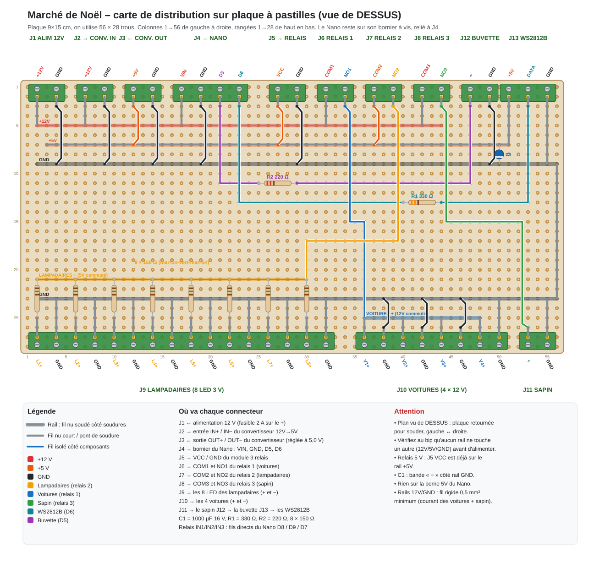

# 🎄 Marché de Noël miniature – Arduino Nano

Sketch : [`village_noel.ino`](village_noel.ino) (bibliothèque **FastLED** requise).

## Matériel

| Élément | Commande | Effet |
|---|---|---|
| 4 LED WS2812B (cabanes) | **D6** | Bougie · guirlande multicolore · rouge↔vert · doré qui respire ; elles s'allument une par une au crépuscule |
| Buvette (LED 5 V) | **D5** directement | Lumière chaude qui vacille comme une lanterne |
| 8 LED 3 V (lampadaires) | Relais 2 sur **D9** | S'allument en premier à la tombée de la nuit |
| 4 voitures 12 V | Relais 1 sur **D8** | Les phares s'allument de temps en temps la nuit (20–40 s), clignotent en mode FÊTE |
| Sapin 12 V | Relais 3 sur **D7** | S'allume en pleine nuit |
| 2 interrupteurs ON/OFF (option) | **D2** et **D4** → GND | Choisissent le mode |

Plus : alimentation 12 V, convertisseur 12 V → 5 V, Nano sur bornier à vis, module 3 relais, Wago.

**Modes** (1 à 4 flashs bleus sur la 1ʳᵉ LED pour confirmer) :

| Inter D2 | Inter D4 | Mode |
|---|---|---|
| OFF | OFF | **AUTO** : cycle jour (2 min) → crépuscule → nuit (8 min) → aube |
| ON | OFF | **NUIT** : tout allumé |
| OFF | ON | **FÊTE** : arc-en-ciel dans les cabanes, voitures qui clignotent |
| ON | ON | **ARRÊT** |

Sans interrupteur, le village est en mode **AUTO**.

## Schéma d'ensemble

```
                 ┌──────── fusible 2 A ────────┐
 ALIM 12 V (+) ──┘                             ▼
                                        [WAGO +12V]──► VIN du Nano
                                             │    ├──► IN+ du convertisseur 12V→5V
                                             │    ├──► COM relais 1 ──NO──► (+) des 4 voitures
                                             │    └──► COM relais 3 ──NO──► (+) du sapin
                                             │
                     convertisseur OUT+ ──► [WAGO +5V]──► VCC module relais
                                                     ├──► 5V des WS2812B
                                                     └──► COM relais 2 ──NO──► lampadaires (via résistances)

 ALIM 12 V (−) ──► [WAGO GND] ◄── tout le reste : GND Nano, IN−/OUT− convertisseur, GND relais,
                                  GND WS2812B, (−) voitures, (−) sapin, (−) lampadaires, (−) buvette, interrupteurs
```

Il faut 3 Wago de 5 entrées (+12V, +5V, GND). Ajoutez-en un 2ᵉ pour le GND s'il manque des places.

## Montage propre : carte de distribution sur plaque à pastilles



La carte remplace tous les Wago. Elle regroupe les rails +12V, +5V et GND, les 8 résistances des lampadaires, la résistance des WS2812B et le condensateur. Chaque élément du marché arrive sur **son propre bornier à vis**. Le Nano reste sur son bornier et se relie à la carte par 4 fils (J4). Les 3 fils IN des relais vont directement du Nano au module relais (D8 → IN1, D9 → IN2, D7 → IN3).

Plan vu **de dessus**. Repères : colonne 1→56 de gauche à droite, rangée 1→28 de haut en bas.

### Matériel
- Plaque à pastilles **9×15 cm**
- Borniers à vis au pas de 5,08 mm, emboîtables : **23 × 2 plots + 1 × 3 plots**
- 8 résistances de **150 Ω** (lampadaires), 1 de **330 Ω** (R1), 1 condensateur **1000 µF 16 V** (C1)
- Fil rigide nu de 0,5 mm² minimum pour les rails, et du fil isolé fin

### Les rails (fil nu, côté soudures)

| Rail | Rangée | Colonnes |
|---|---|---|
| +12V | 5 | 2 → 44 |
| +5V | 7 | 3 → 51 |
| GND (haut) | 9 | 2 → 56 |
| LAMPADAIRES + (5 V commuté par le relais 2) | 21 | 2 → 30 |
| GND (bas) | 23 | 2 → 56 |
| VOITURES + (12 V commuté par le relais 1) | 25 | 36 → 48 |
| Liaison GND haut ↔ bas | colonne 56 | rangées 9 → 23 |

### Ordre de soudure
1. Les **rails** en fil nu.
2. Les **8 résistances de 150 Ω**, debout entre le rail LAMPADAIRES+ (r21) et la rangée 25, colonnes 2, 6, 10 … 30.
3. **R1 330 Ω** couchée en rangée 13, entre les colonnes 40 et 44. **C1** en colonne 50 : + sur le rail +5V (r7), − sur le rail GND (r9).
4. Les **borniers**, vis vers l'extérieur.
5. Les **fils nus courts** et les **fils isolés**, comme sur le plan.

### Liaisons qui croisent un autre rail : en fil isolé
- **+5V** de J3, J5 (VCC) et J7 (COM2) → rail +5V
- **GND** de J1, J2, J3, J4, J5 et J12 → rail GND
- **GND** des voitures V1 à V3 → rail GND bas
- **D5** (J4) → BUVETTE + (J12)
- **D6** (J4) → R1 → DATA (J13)
- **NO1** → rail VOITURES+, **NO2** → rail LAMPADAIRES+, **NO3** → SAPIN + (J11)

Toutes les autres liaisons sont des fils nus courts dans la même colonne, qui ne croisent rien.

### Contrôle avant de brancher
1. Multimètre en mode bip, rien de branché : **aucun bip** entre +12V et GND, +5V et GND, +12V et +5V.
2. Bip entre chaque borne « GND » et le bornier J1 GND : il doit biper partout.
3. Alimentez avec seulement le convertisseur branché, réglez-le à **5,0 V** (mesuré sur J13 +5V et GND).

## Câblage pas à pas (version Wago, ou pour comprendre la carte)

### 1. Alimentation
- **+12 V** (avec fusible 2 A) → Wago +12V → **VIN** du Nano et **IN+** du convertisseur.
- **−** de l'alim → Wago GND → **GND** du Nano et **IN−** du convertisseur.
- **Réglez le convertisseur à 5,0 V au multimètre** avant de brancher quoi que ce soit sur sa sortie.
- Convertisseur **OUT+** → Wago +5V ; **OUT−** → Wago GND.
- ⚠️ Ne branchez **rien** sur la borne **5V** du Nano : il est alimenté par VIN.

### 2. Module 3 relais
- Côté commande : **VCC** → Wago +5V, **GND** → Wago GND, **IN1 → D8** (voitures), **IN2 → D9** (lampadaires), **IN3 → D7** (sapin).
- Les relais sont des modèles **5 V** : VCC sur le 5 V.
- Si les relais fonctionnent « à l'envers », passez `RELAIS_ACTIF_BAS` à `false` dans le programme.

### 3. Les 4 voitures (12 V), sur le relais 1
- Wago +12V → **COM relais 1** ; **NO relais 1** → un Wago qui réunit les (+) des 4 voitures.
- Les (−) des 4 voitures → Wago GND.
- Les 4 voitures sont branchées **en parallèle** (chacune reçoit 12 V).

### 3 bis. Le sapin (12 V), sur le relais 3
- Wago +12V → **COM relais 3** ; **NO relais 3** → (+) du sapin.
- (−) du sapin → Wago GND.

### 4. Les 8 lampadaires (LED 3 V), sur le relais 2
Une LED « 3 V » ne supporte ni le 5 V ni le 12 V en direct : il faut **une résistance par LED** (une résistance commune fonctionne mal avec des LED en parallèle).

```
Wago +5V ──► COM relais 2
             NO relais 2 ──► Wago « lampadaires + »
                               ├── 150 Ω ──► (+) LED 1 (−) ──► GND
                               ├── 150 Ω ──► (+) LED 2 (−) ──► GND
                               └── … ×8
```
- 8 résistances de **150 Ω** (environ 13 mA par LED, bien lumineux), quelques centimes pièce.
- Pratique : mettez les 8 résistances sur une **petite breadboard** cachée sous le décor.
- Repérez le (+) de chaque LED : patte longue, ou fil rouge.
- *Sans résistance* : vous pouvez faire 2 groupes de 4 LED **en série** sur le 12 V (4 × 3 V = 12 V), mais c'est limite. Elles risquent de chauffer, de vieillir vite ou d'être faibles. Ajoutez au moins 47 Ω par groupe.

### 5. La buvette (LED 5 V)
- **(+) → D5**, **(−) → GND**. Elle vacille comme une lanterne.
- Une LED vendue « 5 V » a normalement sa résistance intégrée. Si c'est une LED nue, ajoutez **220 Ω** en série.

### 6. Les 4 WS2812B (cabanes)
- **5V** → Wago +5V, **GND** → Wago GND.
- **D6 → résistance 330 Ω → DIN** de la 1ʳᵉ LED. Puis **DOUT → DIN** de la suivante, et ainsi de suite.
- Conseillé : un condensateur **1000 µF** entre 5V et GND près de la 1ʳᵉ LED (bande « − » sur le GND).
- Respectez le sens des flèches sur les LED (DIN → DOUT).

### 7. Interrupteurs (option)
- Interrupteur 1 : une patte → **D2**, l'autre → GND.
- Interrupteur 2 : une patte → **D4**, l'autre → GND.

## Récapitulatif du bornier du Nano

| Borne Nano | Branché sur |
|---|---|
| VIN | Wago +12V |
| GND | Wago GND |
| 5V | **rien** |
| D2 | Interrupteur 1 (option) |
| D4 | Interrupteur 2 (option) |
| D5 | (+) buvette |
| D6 | 330 Ω → DIN des WS2812B |
| D7 | IN3 relais (sapin) |
| D8 | IN1 relais (voitures) |
| D9 | IN2 relais (lampadaires) |

## Bilan électrique
- 5 V : WS2812B (max 240 mA) + lampadaires (environ 105 mA) + relais (environ 210 mA) + buvette (environ 20 mA), soit **environ 0,6 A**. Un convertisseur de 2 A ou plus est confortable.
- 12 V : voitures + sapin + convertisseur, soit **environ 1 A** selon le sapin. Une alimentation 12 V de 2 A est confortable.

## Avant la première mise sous tension
1. Nano débranché, multimètre en mode bip : **aucun bip** entre +12V et GND, ni entre +5V et GND.
2. Alimentez **sans le Nano ni les LED**, réglez le convertisseur à 5,0 V.
3. Coupez, branchez tout, rallumez.
4. Testez les relais un par un (ils doivent claquer) avant de fermer le décor.

## Pour aller plus loin
- **Photorésistance** sur A0 (+ 10 kΩ vers GND) et `UTILISER_LDR = true` : le marché s'allume tout seul quand la pièce s'assombrit.
- **Module MP3 DFPlayer Mini** (environ 3 €) : musique de Noël en mode FÊTE.
