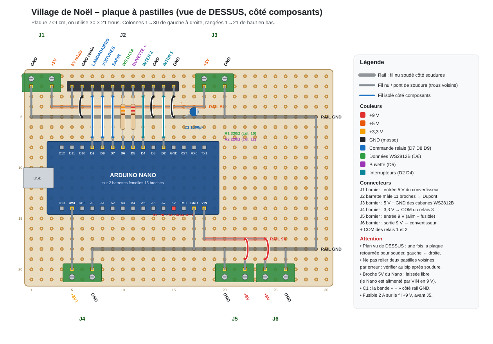

# 🎄 Village de Noël – Arduino Nano

Sketch : [`village_noel.ino`](village_noel.ino) (bibliothèque **FastLED** requise).

## Ce que fait l'installation

| Élément | Commande | Effet |
|---|---|---|
| 8 lampadaires (3,3 V) | Relais 3 sur **D9** | S'allument en premier à la tombée de la nuit |
| Buvette (LED 5 V) | **D5** (PWM) | Lumière chaude qui vacille comme une lanterne |
| 3 cabanes WS2812B | **D6** | Cabane 1 : bougie / blanc chaud · Cabane 2 : guirlande multicolore · Cabane 3 : rouge ↔ vert. Elles s'allument une par une au crépuscule |
| Sapin 9 V | Relais 1 sur **D7** | S'allume à la nuit tombée |
| Feux des 3 voitures 9 V | Relais 2 sur **D8** | « Passent » de temps en temps la nuit (allumés 20–40 s, éteints 8–20 s) |
| 2 interrupteurs ON/OFF | **D2** et **D4** → GND | Choisissent le mode |
| Photorésistance (option) | **A0** | Le village s'allume tout seul quand la pièce s'assombrit |

**Modes** avec 2 interrupteurs ON/OFF (1 à 4 flashs bleus sur la 1ʳᵉ LED pour confirmer) :

| Inter D2 | Inter D4 | Mode |
|---|---|---|
| OFF | OFF | AUTO |
| ON | OFF | NUIT |
| OFF | ON | FÊTE |
| ON | ON | ARRÊT |

Avec un seul interrupteur : mettre `NB_INTERRUPTEURS 1`, chaque basculement passe au mode suivant (`TYPE_INTERRUPTEUR = false` pour un bouton poussoir).

1. **AUTO** – cycle jour (2 min) → crépuscule (20 s) → nuit (8 min) → aube. Démarre au crépuscule.
2. **NUIT** – tout allumé en permanence.
3. **FÊTE** – arc-en-ciel + paillettes dans les cabanes, feux des voitures qui clignotent.
4. **ARRÊT** – tout éteint.

## Alimentation

```
Alim 9 V (+) ──┬──────────────► VIN du Nano
               ├──────────────► COM relais 1 ──NO──► (+) sapin
               ├──────────────► COM relais 2 ──NO──► (+) feux voitures
               └──► Convertisseur 9V→5V ──► Rail 5 V
                                             ├─► VCC modules relais
                                             ├─► 5V WS2812B (+ condensateur 1000 µF)
                                             ├─► (+) buvette
                                             └─► COM relais 3 ──NO──► R ──► (+) lampadaires

TOUS LES GND (alim, convertisseur, Nano, relais, WS2812B, lampadaires, sapin, voitures) RELIÉS ENSEMBLE
```

- **Réglez le convertisseur à 5,0 V au multimètre AVANT** de brancher quoi que ce soit dessus.
- Le Nano est alimenté par **VIN en 9 V** : on peut garder l'USB branché pour le téléverser/déboguer sans risque.
- Alim 9 V : prévoir **2 A** ; convertisseur 5 V de type LM2596 (3 A) ou équivalent.

## Câblage détaillé

### Lampadaires (3,3 V) – sur relais 3
```
Rail 5 V ──► COM relais 3
             NO  relais 3 ──► Résistance R ──► (+) lampadaires
                                               (−) lampadaires ──► GND
```

Le relais sert d'interrupteur ; la résistance **R** fait passer le 5 V à ~3,3 V.
Calcul de **R** : mesurez le courant des lampadaires sous 3 V (2 piles AA font très bien l'affaire), puis
`R = (5 − 3,3) / I`. Exemple : 160 mA → R ≈ 10 Ω, ½ W.

> Sans multimètre pour mesurer le courant : **2 diodes 1N4007 en série** (bague grise côté lampadaires) à la place de R font chuter d'environ 1,4 V → ~3,6 V.

### Buvette (LED 5 V)
- LED nue : D5 → résistance 220 Ω → LED → GND.
- LED « 5 V » avec résistance intégrée consommant **< 20 mA** : D5 → LED → GND directement.
- Si elle consomme plus : passez aussi par un petit MOSFET/transistor.

### Cabanes WS2812B
- 5 V et GND depuis le convertisseur (pas depuis le Nano), **condensateur 1000 µF** entre 5 V et GND au début du ruban.
- D6 → **résistance 330 Ω** → DIN de la 1ʳᵉ LED.
- Modifiez `LEDS_PAR_CABANE` dans le sketch selon votre nombre de LED par cabane.

### Relais (sapin, voitures, lampadaires)
- Modules relais : VCC → 5 V, GND → GND, IN1 → D7 (sapin), IN2 → D8 (voitures), IN du 3ᵉ relais → D9 (lampadaires).
- Côté puissance : le **+9 V** passe par COM → NO ; le (−) des éléments retourne au GND.
- Si les relais fonctionnent « à l'envers », passez `RELAIS_ACTIF_BAS` à `false`.

### Interrupteurs & photorésistance (option)
- Chaque interrupteur ON/OFF a 2 pattes utiles : l'une sur D2 (ou D4), l'autre sur GND. Pas de résistance nécessaire (tirage interne activé). S'il a 3 pattes : celle du milieu sur GND, une des deux autres sur la broche.
- LDR entre 5 V et A0, résistance 10 kΩ entre A0 et GND, puis `UTILISER_LDR = true`. Ajustez les seuils 600/300 dans `niveauNuit()` en regardant `analogRead(A0)`.

## Montage sur plaque à pastilles



Plan vu **de dessus** (côté composants). Repères : colonne 1→30 de gauche à droite, rangée 1→21 de haut en bas ; « c10 r3 » = colonne 10, rangée 3.

### Matériel
- Plaque à pastilles 7×9 cm (on utilise 30 × 21 trous)
- 2 barrettes **femelles** 15 broches (le Nano s'enfiche dessus, il reste démontable)
- 1 barrette **mâle** 11 broches (J2) + câbles Dupont femelle-femelle
- 5 borniers à vis 2 plots, pas 5,08 mm (J1, J3, J4, J5, J6)
- R1 330 Ω, R2 220 Ω, C1 1000 µF 16 V
- Fil nu (queue de résistance ou fil rigide dénudé) et fil isolé fin (0,25–0,5 mm²)

### Ordre de soudure (du plus bas au plus haut)
1. **Rails en fil nu** côté soudures : 5V rangée 4 (c3→c18), GND rangée 5 (c1→c29), 9V rangée 17 (c18→c24), GND rangée 18 (c7→c29), et la liaison GND verticale colonne 29 (r5→r18).
2. **Résistances** debout ou couchées, pattes en rangées 3 et 7 : R1 330 Ω en colonne 10, R2 220 Ω en colonne 11.
3. **Barrettes femelles** du Nano : rangée 8 et rangée 14, colonnes 4→18, USB vers le bord gauche.
4. **Barrette J2** (rangée 2, c5→c15) puis les **borniers**, vis tournées vers l'extérieur.
5. **C1** entre le rail 5V (patte +, c16 r4) et le rail GND (patte −, c16 r5).
6. **Ponts et fils** selon le tableau ci-dessous.

### Liste des liaisons

| Liaison | De | Vers | Type |
|---|---|---|---|
| J1 GND | c1 r2 | rail GND (c1 r5) | fil nu |
| J1 +5V | c3 r2 | rail 5V (c3 r4) | fil nu |
| J2 « 5V relais » | c5 r2 | rail 5V (c5 r4) | fil nu |
| J2 « GND » (×3) | c6, c13, c15 r2 | rail GND (r5) | pont r2-r3 + fil isolé noir |
| D9 → LAMPADAIRES | c7 r8 | c7 r2 | ponts r8-r7 et r3-r2 + fil isolé |
| D8 → VOITURES | c8 r8 | c8 r2 | idem |
| D7 → SAPIN | c9 r8 | c9 r2 | idem |
| D6 → R1 → WS DATA | c10 r8 | c10 r2 | ponts r8-r7 et r3-r2, R1 entre r7 et r3 |
| D5 → R2 → BUVETTE + | c11 r8 | c11 r2 | ponts r8-r7 et r3-r2, R2 entre r7 et r3 |
| D4 → INTER 2 | c12 r8 | c12 r2 | ponts + fil isolé |
| D2 → INTER 1 | c14 r8 | c14 r2 | ponts + fil isolé |
| J3 +5V | c18 r2 | rail 5V (c18 r4) | fil nu |
| J3 GND | c20 r2 | rail GND (c20 r5) | fil nu |
| 3V3 Nano → J4 + | c5 r14 | c5 r20 | fil nu |
| J4 GND | c7 r20 | rail GND bas (c7 r18) | fil nu |
| GND Nano | c17 r14 | rail GND bas (c17 r18) | fil nu |
| VIN Nano | c18 r14 | rail 9V (c18 r17) | fil nu |
| J5 GND | c20 r20 | rail GND bas | fil nu |
| J5 +9V | c22 r20 | rail 9V (c22 r17) | pont r20-r19 + fil isolé rouge (passe au-dessus du rail GND) |
| J6 +9V | c24 r20 | rail 9V (c24 r17) | idem |
| J6 GND | c26 r20 | rail GND bas | fil nu |

> ⚠️ La broche **5V du Nano** (c15 r14) reste **libre**. Le Nano est alimenté en 9 V par VIN.

### Ce qui se branche sur la plaque

| Connecteur | Va vers |
|---|---|
| J1 | Sortie du convertisseur 9V→5V (OUT+ / OUT−) |
| J2 « 5V/GND relais », « LAMPADAIRES/VOITURES/SAPIN » | VCC, GND, IN des modules relais (câbles Dupont) |
| J2 « WS DATA » + J3 | DIN des cabanes WS2812B + leur 5V/GND |
| J2 « BUVETTE + » + un « GND » | LED de la buvette |
| J2 « INTER 1/2 » + « GND » | Les 2 interrupteurs ON/OFF |
| J4 | COM du relais 3 (lampadaires) et GND des lampadaires |
| J5 | Alimentation 9 V, **avec fusible 2 A** sur le + |
| J6 | Entrée du convertisseur (IN+ / IN−) et COM des relais 1 et 2 ; GND des sapin et voitures |

### Avant la première mise sous tension
1. **Nano retiré**, multimètre en mode bip : aucun bip entre 9V et GND, entre 5V et GND, ni entre 3V3 et GND.
2. Vérifiez au bip chaque liaison du tableau.
3. Alimentez sans le Nano : 9 V sur J6, puis réglez le convertisseur pour avoir 5,0 V sur J3.
4. Coupez, enfichez le Nano, puis rallumez.

## Pour aller plus loin
- **MOSFET** (IRLZ44N, ~1 €) à la place des relais → lampadaires qui crépitent puis s'allument en fondu, sapin qui « respire », sans claquement.
- **Module MP3 DFPlayer Mini** (~3 €) → musique de Noël en mode FÊTE.
- **Capteur PIR** → le village se réveille quand quelqu'un s'approche.
